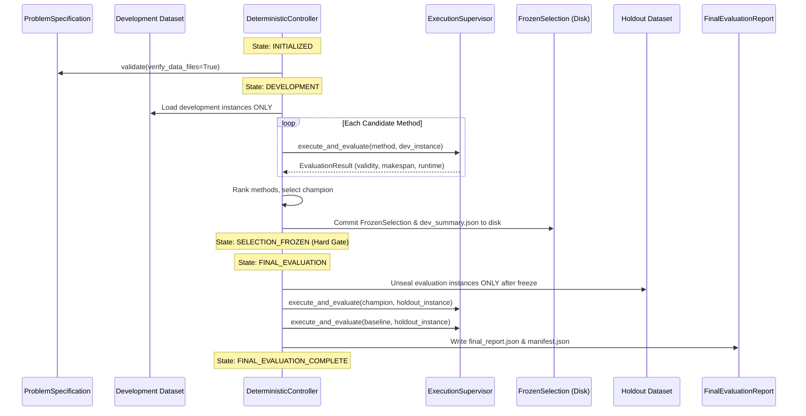

# AMAURA LABS — NORTH BLUESTAR DISCOVERY KERNEL V0.1
## Data Flow, Information Access & Execution Isolation Analysis

**Document:** `discovery_kernel_v01/DATA_FLOW_AND_ISOLATION.md`  
**System:** North BlueStar — Discovery Kernel v0.1  
**Date:** October 19, 2026  

---

## 1. Development vs. Final-Evaluation Separation Architecture

One of the primary vulnerabilities identified in previous repository audits was **holdout data leakage** (where candidate search or model prompt generation inadvertently inspected holdout test scores or where soft variables allowed selection logic to access test metrics).

Discovery Kernel v0.1 implements **architectural and state-machine enforced separation**:



### Architectural Enforcement Points:

1. **Cryptographic Reference Binding:**
   - On controller initialization, both `development_dataset` and `evaluation_dataset` are verified against declared SHA-256 digests (`DatasetReference.verify()`). If either file is missing, altered, or instance counts mismatch, the controller halts before any evaluation occurs.
2. **Strict Phase Sequencing:**
   - In `run_development_phase()`, the controller reads exclusively from `problem_spec.development_dataset.file_path`.
   - The selection logic never sees, references, or opens `problem_spec.evaluation_dataset.file_path`.
   - Attempting to invoke `run_final_evaluation_phase()` before the selection is frozen raises an uncatchable `ControllerStateError`.
3. **Immutable Frozen Artifact:**
   - The selection is captured in an immutable `@dataclass(frozen=True)` object: `FrozenSelection`.
   - It records the champion method ID, version, development score, rankings, timestamp, and a SHA-256 hash of the complete development evidence.
   - When `run_final_evaluation_phase()` is called, it verifies that the candidate adapter matches `frozen_selection.champion_method_id` and that the problem specification fingerprint has not changed.

---

## 2. Information Flow and Access Boundaries

```
[Candidate Method (Child Process)]
   |  Only receives: instance input data (e.g. processing_times matrix)
   |  Returns: raw solution (e.g. list of job indices)
   v
[Supervisor Boundary (IPC Queue)]
   |  Receives: output, runtime_ms, error status
   v
[Constraint Validation (Supervisor / Parent Process)]
   |  Runs: ConstraintRule.check(instance, output)
   |  Output: is_valid (bool), validation_errors (list)
   v
[Common Problem Evaluator (Supervisor / Parent Process)]
   |  Runs ONLY if is_valid == True
   |  Computes: objective_score (float)
   v
[Controller & Evidence Store]
   |  Aggregates rankings, logs raw records, enforces selection rules
```

### Critical Access Invariants:
- **No Evaluator Tampering:** Candidate code never calls `calc_makespan()`, never defines its own reward function, and cannot pass a fake score back to the controller. The evaluator runs solely in the supervisor parent process.
- **No Constraint Bypass:** Candidates cannot suppress validation errors or return arbitrary data types to escape penalty logic.
- **No Holdout Peeking:** Because the child worker process is spawned on individual development instances, it has zero access to the controller instance, the dataset files, or the holdout benchmark.

---

## 3. Execution Isolation: Capabilities & Threat Model Limitations

The `ExecutionSupervisor` employs OS-level process isolation via Python's `multiprocessing.get_context("spawn")`.

### What This Isolation Level Demonstrably Guarantees:

1. **Process Separation:**  
   The candidate code runs in a distinct OS process with its own private address space, heap, memory allocators, and Global Interpreter Lock (GIL).
2. **Crash & Segfault Containment:**  
   If a candidate crashes (e.g. fatal C-extension error, out-of-memory kill, or recursion depth crash), only the worker process exits. The parent supervisor detects the non-zero exit code (`proc.exitcode`), logs an `ExecutionStatus.EXCEPTION`, and proceeds to the next candidate without crashing.
3. **True Hard Timeout Termination:**  
   When `timeout_sec` expires, the supervisor sends `proc.terminate()` (SIGTERM), waits 200ms, and if still alive, sends `proc.kill()` (SIGKILL). This guarantees that infinite loops (`while True: pass`) or unresponsive workers are forcibly removed from the operating system.
4. **State Sanitization:**  
   Because a fresh process is spawned for worker tasks, no module-level global variables or modified built-ins can contaminate subsequent candidate evaluations.

### What This Isolation Level DOES NOT Guarantee (Threat Model Limits):

> [!WARNING]
> Python process isolation is an **engineering reliability boundary**, NOT a **military-grade security sandbox against adversarial or hostile code**.

The limits of this mechanism must be explicitly documented:

1. **Hostile Filesystem Access:**  
   In Discovery Kernel v0.1, the worker process runs under the local user account (`ashishsingh`). Without OS-level filesystem chrooting, mount namespaces, or sandbox wrappers, an explicitly malicious candidate could theoretically read files from the filesystem if not restricted by AST checks.
2. **Local Network Sockets:**  
   The child process inherits network capabilities from the parent process. An adversarial candidate could attempt to open a socket connection unless network namespaces or firewall rules are applied.
3. **OS-Specific Resource Limits:**  
   While CPU limits are backed by `resource.setrlimit(RLIMIT_CPU)` on Unix, memory limits (`RLIMIT_AS`) are platform-dependent (macOS Darwin ignores `RLIMIT_AS` for malloc, unlike Linux).

### Production Recommendation for North BlueStar Phase 2:
When North BlueStar advances to accepting arbitrary, unverified code from third-party frontier LLMs or untrusted web submissions, `ExecutionSupervisor` should be wrapped in an **OCI container runtime** (e.g., Docker / Podman / gVisor) with:
- `--network none` (complete network isolation)
- `--read-only` (read-only root filesystem with ephemeral memory tmpfs)
- `--security-opt no-new-privileges`
- Memory and CPU quotas enforced by Linux cgroups v2.
