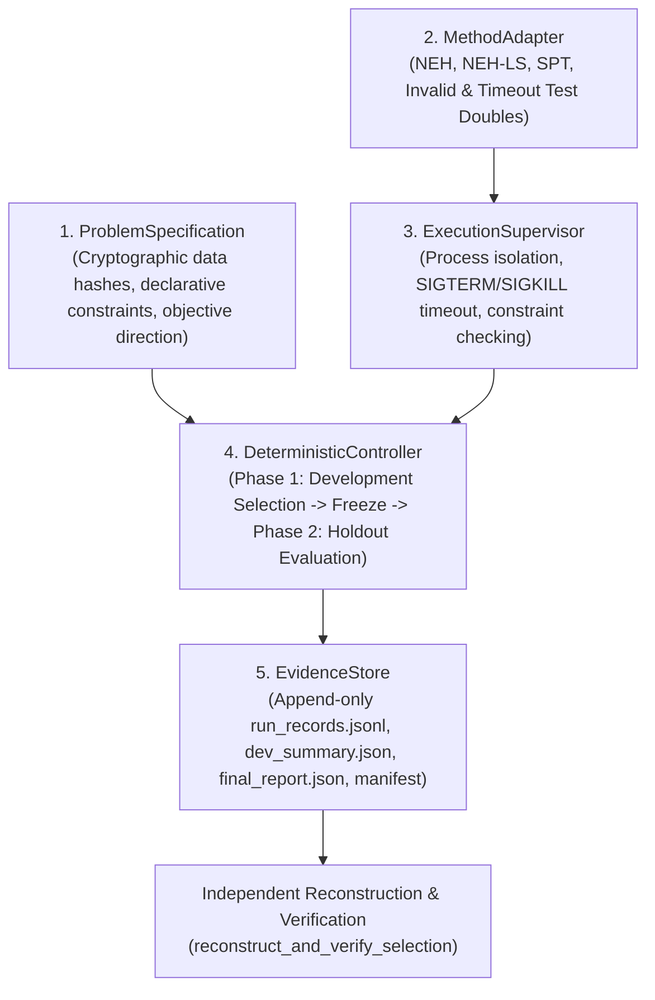

# AMAURA LABS — NORTH BLUESTAR DISCOVERY KERNEL V0.1
## Implementation Summary & Architecture Document

**Date:** October 19, 2026  
**Author:** Lead Research Infrastructure Engineer, Amaura Labs  
**System:** North BlueStar — Discovery Kernel v0.1  
**Repository State:** Clean working tree on branch `search-benchmark-v1` (uncommitted artifacts preserved for review)  

---

## 1. Executive Summary

Discovery Kernel v0.1 establishes the foundational, method-agnostic experimental harness for **North BlueStar**. 

Rather than attempting to prove an unverified algorithm discovery hypothesis, this milestone establishes a **trustworthy, reusable, and mathematically auditable experimental kernel**. It addresses the historical issues identified in previous audits (such as holdout-score leakage, soft timeouts, non-deterministic tie-breaking, and inconsistent instance subsets) by implementing five minimal, decoupled capabilities with rigorous correctness gates.

---

## 2. Five Minimal Capabilities Implemented

### A. Problem Specification (`discovery_kernel/problem_spec.py`)
- **Structured Contract:** Defined via `ProblemSpecification` dataclass.
- **Declarative Constraints:** Replaces ad-hoc checking with explicit `ConstraintRule` objects. A candidate cannot be evaluated or scored unless it passes all declarative constraint checks.
- **Cryptographic Dataset References:** `DatasetReference` binds development and holdout splits by file path, expected instance count, and SHA-256 digest.
- **Resource Limits:** `ResourceLimits` strictly bounds per-instance runtime, total phase time, and evaluation count.
- **Immutable Fingerprint:** The specification computes a deterministic SHA-256 digest over all contract fields (`compute_fingerprint()`).

### B. Method Adapter (`discovery_kernel/method_adapter.py`)
- **Unified Interface:** `MethodAdapter` ABC defines a uniform `solve(instance) -> solution` contract for conventional algorithms, heuristics, and generated scripts alike.
- **Supported Deterministic Methods:** Reuses verified PFSP algorithms:
  - `PFSPNEHAdapter`: Nawaz-Enscore-Ham (1983) constructive baseline.
  - `PFSPNEHLSAdapter`: NEH constructive heuristic + single-pass insertion local search.
  - `PFSPSPTAdapter`: Shortest Processing Time heuristic.
  - `PFSPFunctionAdapter`: Wraps arbitrary callable algorithms.
- **Fault-Injection Test Doubles:**
  - `InvalidPermutationAdapter`: Produces duplicate job indices to test constraint rejection.
  - `HangingAdapter`: Sleeps past timeout to test worker process kill.
  - `ExceptionAdapter`: Raises unhandled `RuntimeError` to test supervisor fault containment.

### C. Evaluation & Execution Layer (`discovery_kernel/execution.py`)
- **True Process Isolation:** Uses `multiprocessing.get_context("spawn")` to run candidate methods in isolated child processes.
- **Hard Timeout Enforcement:** When a method exceeds `timeout_sec`, the supervisor sends `SIGTERM`, waits 200ms, and escalates to `SIGKILL` if still alive. This prevents thread hangs and runaway loops.
- **Clean Failure Classification:** Distinct statuses: `SUCCESS`, `VALIDATION_ERROR`, `EXCEPTION`, `TIMEOUT`, `RESOURCE_EXHAUSTED`.
- **Decoupled Scoring:** Evaluator scoring is executed strictly in the supervisor after constraint validation passes. Invalid candidates never receive an objective score that could exploit scoring conventions.

### D. Experiment Controller (`discovery_kernel/controller.py`)
- **Strict Phase Sequencing:** State machine (`INITIALIZED` -> `DEVELOPMENT` -> `SELECTION_FROZEN` -> `FINAL_EVALUATION_COMPLETE`).
- **Phase 1 (Development Selection):** Evaluates candidate methods on development instances only. Disqualifies invalid/failing candidates. Enforces evaluation budget limits.
- **Deterministic Ranking:** Sorts by validity status, objective score (direction-aware: lower for `MINIMIZE`, higher for `MAXIMIZE`), and `method_id` alphabetical order. **Runtime is explicitly excluded from tie-breaking** to eliminate non-deterministic CPU scheduling noise.
- **Immutable Freezing:** Emits `FrozenSelection` before any access to holdout data.
- **Phase 2 (Confirmatory Holdout Evaluation):** Requires frozen selection. Unseals evaluation split, evaluates frozen champion and baselines, and computes both overall and instance-matched relative gaps.

### E. Evidence Store (`discovery_kernel/evidence_store.py`)
- **Append-Only Logging:** `run_records.jsonl` logs every instance execution with UUID, timestamp, method metadata, instance ID, validation status, objective score, runtime, and errors.
- **Cryptographic Manifest:** `manifest.json` records SHA-256 digests and byte sizes of all output artifacts.
- **Automated Reconstruction:** `reconstruct_and_verify_selection()` recomputes rankings directly from raw instance logs and verifies that the recorded champion matches mathematical evidence.

---

## 3. Reused Components and Lineage

To satisfy **Gate A (Reuse)**, the implementation directly builds upon reliable existing repository modules:

1. **PFSP Scheduling Core:**  
   - Source: [`benchmark_v1/src/domains/pfsp_full_algorithm.py`](file:///Users/ashishsingh/Desktop/experiment1/benchmark_v1/src/domains/pfsp_full_algorithm.py)
   - Reused: `calc_makespan()`, `validate_permutation()`, `neh_solve()`, `neh_ls_solve()`.
2. **Process Isolation & Hardening Principles:**  
   - Source: [`stage4/src/evaluator.py`](file:///Users/ashishsingh/Desktop/experiment1/stage4/src/evaluator.py)
   - Reused: Multiprocessing spawn context, timeout termination pattern (SIGTERM -> SIGKILL), fail-closed error handling.
3. **Cryptographic Data Quarantines:**  
   - Source: [`stage4/src/benchmark.py`](file:///Users/ashishsingh/Desktop/experiment1/stage4/src/benchmark.py)
   - Reused: SHA-256 dataset verification pattern, manifest generation.

---

## 4. Key Design Decisions & Improvements Over Historical Systems

| Design Dimension | Historical Approach (Stage 2/3/Benchmark V1) | Discovery Kernel v0.1 Approach | Rationale |
| :--- | :--- | :--- | :--- |
| **Tie-Breaking** | Used execution time or random seed order | Strictly `(valid_rank, score_rank, method_id)` | Eliminates non-deterministic champion flips caused by microsecond OS scheduling jitter. |
| **Instance Subsets** | Dropped timed-out instances and computed raw averages | Evaluates matched subsets and records explicit validity rates | Prevents artificially deflated makespan scores caused by dropping difficult instances. |
| **Holdout Access** | Soft variable separation in runner loops | State-machine gated access requiring immutable `FrozenSelection` | Guarantees holdout data cannot leak into candidate selection logic. |
| **Worker Timeouts** | Thread-based wait loops or in-process signal handlers | OS process spawn with SIGTERM/SIGKILL termination | Eliminates lingering workers, thread state corruption, and platform-specific signal limitations. |
| **Constraint Validation** | Embedded inside candidate compilation | Decoupled declarative `ConstraintRule` checked post-execution | Prevents candidates from monkey-patching or bypassing validation rules. |

---

## 5. Artifact Inventory

- `discovery_kernel/`: Modular Python package.
  - `problem_spec.py`: Problem specification, constraints, dataset references.
  - `method_adapter.py`: Adapter ABC, concrete PFSP adapters, test doubles.
  - `execution.py`: Process-isolated execution supervisor.
  - `evidence_store.py`: Append-only event logging, manifest, reconstruction.
  - `controller.py`: Deterministic experiment controller, state machine, holdout gating.
  - `run_pilot.py`: End-to-end integration pilot runner script.
- `tests/test_discovery_kernel.py`: 11 focused automated unit and integration tests (100% passing).
- `discovery_kernel_v01/results/pilot_20261019/`: Machine-readable pilot records (`run_records.jsonl`, `dev_summary.json`, `final_report.json`, `manifest.json`).
