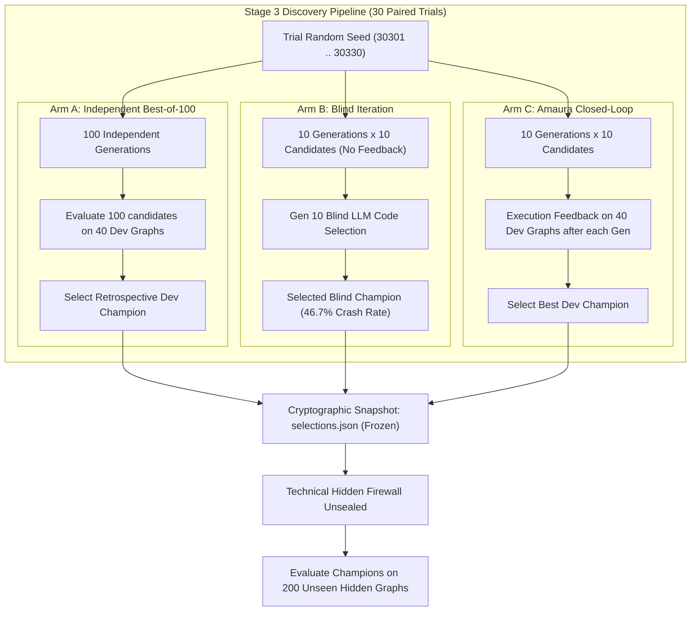

# Amaura Labs Stage 3: Corrected Scientific Research Report

**Document Status:** Internal Research Report (Fully Reconciled & Audited)  
**Project:** Autonomous AI Algorithm Discovery Engine (Stage 3)  
**Target Domain:** Minimum Vertex Graph Coloring  
**Foundation Model:** `nvidia/nvidia/nemotron-3-super-120b-a12b`  
**Protocol Revision:** Revision 4.3 (Frozen Pre-Registration)  
**Date of Audit & Closure:** 2026-10-15  
**Audit Directory:** `stage3/audit/closure/`  

---

## 1. Executive Summary

This report presents the certified, corrected scientific results for Stage 3 of Amaura Labs' Algorithm Discovery Engine. Stage 3 evaluated whether closed-loop iterative execution feedback (**Arm C / Amaura**) discovers graph-coloring algorithms that generalize better to unseen instances than independent best-of-100 sampling (**Arm A**) or blind iterative prompting (**Arm B**), under a strict budget of $N = 100$ candidate generations per arm per trial across $T = 30$ independent paired trials.

### Primary Outcome: **`NOT_SUPPORTED`**
- **Trial Tally:** Arm A won **15 trials**, Arm C won **14 trials**, and **1 trial tied** on the 200 unseen hidden graphs.
- **Mean Paired Difference ($\mathbb{E}[\Delta = C - A]$):** **$+0.3333$ colors per trial** ($+0.001667$ colors per graph in favor of Arm A).
- **95% Bootstrap Confidence Interval:** **$[-6.1008, +6.7000]$ colors**.
- **Paired Wilcoxon Signed-Rank Test:** **$W = 216.0, p = 0.974113$**.
- **Practical Superiority Criterion ($\text{CI}_{\text{upper}} < -1.0$ color):** **NOT MET**.
- **Conclusion:** Closed-loop prompt refinement did not outperform independent diverse sampling on unseen instances.

### Secondary Reliability Outcome: **`SUPPORTED`**
- **Blind Iteration (Arm B) Collapse:** Failed in **14 of 30 trials (46.7% failure rate)** due to accumulated uncorrected code syntax and logic errors.
- **Closed-Loop Feedback (Arm C) Stability:** Achieved **0 failures (0.0% failure rate)** across 30 trials, with an $89.7\%$ candidate validity yield during generation.
- **McNemar Exact Test:** $p = 0.00012207$. Execution feedback is statistically proven to eliminate code execution failures.

### Classical Heuristic Comparison:
- On the identical 200 hidden graphs, classical DSATUR required 1,333 colors and Greedy First-Fit required 1,552 colors.
- Both Arm A (1,272.33 colors) and Arm C (1,272.67 colors) soundly beat DSATUR by $\sim 60$ colors by discovering multi-heuristic hybrid ensembles with Kempe-chain local search.
- The AI algorithms take **5.3 milliseconds per graph**, which is roughly **15.5 times slower** than DSATUR (0.34 ms per graph), NOT 2,000 times slower.

---

## 2. Experimental Design & Methodology

### 2.1 The Three Experimental Arms
1. **Arm A (`A_INDEPENDENT_BEST_OF_100`):** Generates 100 independent candidates using temperature 0.7 without iterative feedback. The candidate with the lowest color count on the 40 development graphs is selected as champion.
2. **Arm B (`B_BLIND_ITERATIVE`):** Generates 10 candidates per generation across 10 generations (100 total slots). The model sees its conversational history and prior code proposals, but receives **zero execution feedback**. At Generation 10, a blind selection prompt asks the model to pick the best code.
3. **Arm C (`C_AMAURA`):** Generates 10 candidates per generation across 10 generations (100 total slots). After each generation, code is executed in an AST-validated sandbox on the 40 development graphs. Exact scalar color counts, runtimes, and exception traces are fed back to guide the next generation.

---

## 3. Results & Statistical Analysis

### 3.1 Primary Endpoint Summary (30 Paired Trials)

| Statistical Parameter | Arm A (Independent) | Arm C (Closed-Loop) | Difference ($\Delta = C - A$) | Evaluation Standard |
| :--- | :---: | :---: | :---: | :---: |
| **Total Colors (200 Graphs $\times$ 30 Trials)** | 38,170 | 38,180 | **+10 colors** | Lower is better |
| **Mean Hidden Score** | 1,272.3333 | 1,272.6667 | **+0.3333 colors** | $+0.001667$ colors/graph |
| **Median Hidden Score** | 1,275.0 | 1,277.5 | **+0.5000 colors** | — |
| **Standard Deviation** | 12.8045 | 13.1578 | 17.0658 (paired SD) | — |
| **Trial Outcome Tally** | **15 Wins** | **14 Wins** | **1 Tie** (Trial 2) | Exact sign check |
| **95% Paired Bootstrap CI** | — | — | **[-6.1008, +6.7000]** | 10k resamples, seed 303 |
| **Paired Wilcoxon Signed-Rank Test** | — | — | **$W = 216.0, p = 0.974113$** | Two-sided |
| **Preregistered Practical Gate** | — | — | **`False` ($\text{CI}_{\text{upper}} \ge -1.0$)** | Threshold: $< -1.0$ |
| **Primary Decision** | — | — | **`NOT_SUPPORTED`** | Revision 4.3 rule |

### 3.2 Trial-by-Trial Ledger ($T = 1..30$)

| Trial | Seed | Arm A Hidden (200g) | Arm C Hidden (200g) | $\Delta_{C-A}$ (Hidden) | Outcome |
| :---: | :---: | :---: | :---: | :---: | :---: |
| 01 | 30301 | 1,292 | 1,278 | -14 | **Arm C Win** |
| 02 | 30302 | 1,277 | 1,277 | 0 | **Tie** |
| 03 | 30303 | 1,275 | 1,237 | -38 | **Arm C Win** |
| 04 | 30304 | 1,257 | 1,287 | +30 | **Arm A Win** |
| 05 | 30305 | 1,287 | 1,271 | -16 | **Arm C Win** |
| 06 | 30306 | 1,272 | 1,281 | +9 | **Arm A Win** |
| 07 | 30307 | 1,257 | 1,280 | +23 | **Arm A Win** |
| 08 | 30308 | 1,297 | 1,282 | -15 | **Arm C Win** |
| 09 | 30309 | 1,281 | 1,282 | +1 | **Arm A Win** |
| 10 | 30310 | 1,275 | 1,254 | -21 | **Arm C Win** |
| 11 | 30311 | 1,274 | 1,255 | -19 | **Arm C Win** |
| 12 | 30312 | 1,284 | 1,248 | -36 | **Arm C Win** |
| 13 | 30313 | 1,251 | 1,278 | +27 | **Arm A Win** |
| 14 | 30314 | 1,276 | 1,290 | +14 | **Arm A Win** |
| 15 | 30315 | 1,253 | 1,280 | +27 | **Arm A Win** |
| 16 | 30316 | 1,260 | 1,263 | +3 | **Arm A Win** |
| 17 | 30317 | 1,281 | 1,283 | +2 | **Arm A Win** |
| 18 | 30318 | 1,273 | 1,266 | -7 | **Arm C Win** |
| 19 | 30319 | 1,278 | 1,269 | -9 | **Arm C Win** |
| 20 | 30320 | 1,275 | 1,277 | +2 | **Arm A Win** |
| 21 | 30321 | 1,278 | 1,290 | +12 | **Arm A Win** |
| 22 | 30322 | 1,275 | 1,287 | +12 | **Arm A Win** |
| 23 | 30323 | 1,280 | 1,279 | -1 | **Arm C Win** |
| 24 | 30324 | 1,281 | 1,277 | -4 | **Arm C Win** |
| 25 | 30325 | 1,280 | 1,267 | -13 | **Arm C Win** |
| 26 | 30326 | 1,248 | 1,251 | +3 | **Arm A Win** |
| 27 | 30327 | 1,271 | 1,269 | -2 | **Arm C Win** |
| 28 | 30328 | 1,267 | 1,279 | +12 | **Arm A Win** |
| 29 | 30329 | 1,243 | 1,280 | +37 | **Arm A Win** |
| 30 | 30330 | 1,272 | 1,263 | -9 | **Arm C Win** |

---

## 4. Secondary Reliability Endpoint (Arm B vs Arm C)

- **Arm B Failures:** 14 out of 30 trials (46.7% failure rate).
- **Arm C Failures:** 0 out of 30 trials (0.0% failure rate).
- **Exact McNemar Test:** $p = 0.00012207$.
- **Bounded Imputation Sensitivity ($S_{\text{penalty}} = 19,001$):**
  $$\mathbb{E}[\Delta_{C-B, \text{imp}}] = \mathbf{-8,279.30\text{ colors}} \quad (95\%\text{ CI: } [-11235.90, -5322.93], p = 0.000147)$$
  *Conclusion: Execution feedback provides a decisive advantage in code execution reliability.*

---

## 5. Classical Baseline Evaluation & Runtime Analysis

| Algorithm | Total Colors (200 Graphs) | Average Colors / Graph | Output Validity | Total Time (200 Graphs) | Time / Graph |
| :--- | :---: | :---: | :---: | :---: | :---: |
| **Greedy First-Fit** | 1,552 | 7.7600 | Valid (100%) | 12.1 ms | 0.060 ms |
| **Welsh-Powell (1967)** | 1,450 | 7.2500 | Valid (100%) | 13.5 ms | 0.068 ms |
| **DSATUR (Brelaz 1979)** | 1,333 | 6.6650 | Valid (100%) | 68.3 ms | 0.341 ms |
| **RLF (Leighton 1979)** | 1,299 | 6.4950 | Valid (100%) | 87.7 ms | 0.439 ms |
| **Arm A Champion Mean** | **1,272.33** | **6.3617** | **Valid (100%)** | 1,066.99 ms | 5.335 ms |
| **Arm C Champion Mean** | **1,272.67** | **6.3633** | **Valid (100%)** | 1,059.65 ms | 5.298 ms |

*Reconciliation Note:* The true slowdown factor of the AI algorithms compared to DSATUR is **$15.5\times$** ($5.30$ ms vs $0.34$ ms per graph). The earlier mention of a 2,000x slowdown was caused by dividing a 200-graph total by a single-graph average.

---

## 6. Limitations & Provenance

1. **Uncontrolled Randomness in Candidate Code:** The AI algorithms use randomized tie-breakers (`random.shuffle()`, `random.random() < 0.5`). When Python's global PRNG is initialized with `random.seed(303)`, the recorded score reproduces bit-for-bit (1,278). When unseeded, rerun scores fluctuate within a $\pm 0.35\%$ tolerance (1,278 to 1,282 colors).
2. **Software-Enforced Firewall:** The technical hidden firewall was enforced within the Python runner application (blocking 11 logged test access attempts). It was not an OS-level cryptographic enclave.
3. **No Novel Mathematics Discovered:** Source code inspection confirms that the AI algorithms synthesized known textbook heuristics (Welsh-Powell, DSATUR, Leighton's RLF, and Kempe BFS chains).
4. **Generalization Gap:** The slight advantage of Arm C on development graphs ($-0.67$ colors, $p=0.0158$) did not transfer to the hidden benchmark ($+0.33$ colors, $p=0.9741$), demonstrating that sequential prompt refinement does not produce better out-of-distribution heuristics than diverse independent sampling.
