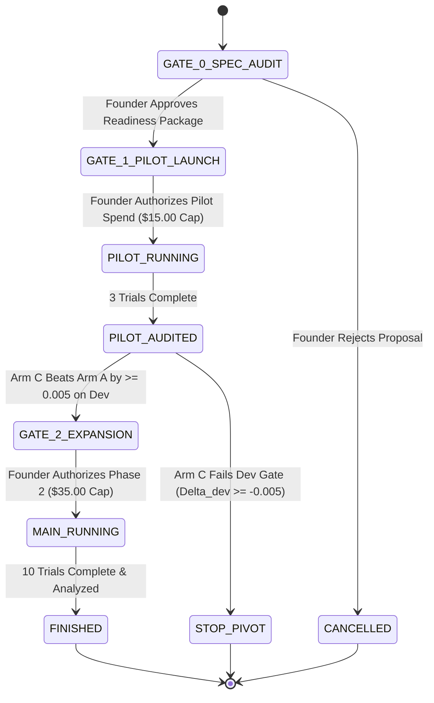

# Stage 4 Resource Budget, Stopping Rules, and Governance Gates

**Document Status:** Formal Financial & Operational Control Plan (Reconciled & Audited)  
**Project:** Autonomous AI Algorithm Discovery Engine (Stage 4)  
**Author:** Senior Research Engineer, Amaura Labs Discovery Engine  
**Date:** 2026-10-15  
**Directory:** `stage4_research_decision/`  

---

## 1. Financial Reconciliation & Cost Modeling

Prior drafts contained apparent arithmetic discrepancies between token counts, illustrative unit rates, and total dollar estimates. Below is the complete mathematical reconciliation:

### 1.1 Comparative Pricing Scenarios

```
┌──────────────────────────────────────────────────────────────────────────────────────────────────┐
│ SCENARIO A: Low-Tier Model Pricing ($2.00 / 1M Input, $6.00 / 1M Output)                         │
├────────────────────────────────┬───────────────────────────────┬─────────────────────────────────┤
│ Phase 1 Pilot (300 calls):     │ 2.10M in ($4.20) + 0.36M out ($2.16)   │ Base Token Cost = $6.36 │
│ Phase 2 Decisive (700 calls):  │ 4.90M in ($9.80) + 0.84M out ($5.04)   │ Base Token Cost = $14.84│
│ Total 10 Trials (1,000 calls): │ 7.00M in ($14.00) + 1.20M out ($7.20) │ Base Token Cost = $21.20│
├────────────────────────────────┴───────────────────────────────┴─────────────────────────────────┤
│ SCENARIO B: Stage 3 Code Rates ($3.00 / 1M Input, $15.00 / 1M Output) + 15% Retry Reserve       │
├────────────────────────────────┬───────────────────────────────┬─────────────────────────────────┤
│ Phase 1 Pilot (300 calls):     │ 2.10M in ($6.30) + 0.36M out ($5.40)   │ Base = $11.70 -> Cap = $13.50 │
│ Phase 2 Decisive (700 calls):  │ 4.90M in ($14.70) + 0.84M out ($12.60) │ Base = $27.30 -> Cap = $31.50 │
│ Total 10 Trials (1,000 calls): │ 7.00M in ($21.00) + 1.20M out ($18.00) │ Base = $39.00 -> Cap = $45.00 │
└────────────────────────────────┴───────────────────────────────┴─────────────────────────────────┘
```

**Reconciliation Note:**  
The earlier proposal's estimates of **$13.50** for the pilot and **$45.00** for the full experiment were based on Stage 3's conservative rate card (`stage3/src/llm_client.py` lines 38–39: $3/$15) plus a **$15\%$ contingency buffer** for network retries and context growth.

To maintain maximum fiscal safety, **we adopt the conservative Scenario B limits**.

---

## 2. Hard Governance Caps vs. Software Tripwires

We establish a two-tier financial control architecture:

```
┌────────────────────────────────────────────────────────────────────────────────────────┐
│                              FORMAL FINANCIAL CEILINGS                                 │
├──────────────────────────────┬──────────────────────────────┬──────────────────────────┤
│ Automatic Software Tripwire: │ $40.00 USD                   │ Graceful wind-down stop  │
│ Hard Governance Ceiling Cap: │ $50.00 USD                   │ Absolute hard abort      │
│ Maximum Total LLM Queries:   │ 1,000 calls                  │ Strict slot counter      │
│ Maximum Total Tokens:        │ 9,000,000 tokens             │ Enforced by client       │
│ Maximum Wall-Clock Time:     │ 5.0 hours                    │ Automatic timeout abort  │
└──────────────────────────────┴──────────────────────────────┴──────────────────────────┘
```

### Provider-Side Billing Reality:
- **Client-Side Enforcement:** Enforced in code by `BudgetEnforcer` (pre-flight checks before each query and atomic ledger persistence).
- **Provider-Side Requirement:** Software cannot prevent provider overages if an API key is compromised. The founder/project lead must configure a hard spend limit of **$50.00** directly in the provider billing console (e.g. OpenAI / OpenRouter spending limits).

---

## 3. Hard Stopping Conditions (Automatic Tripwires)

The experiment orchestrator will automatically halt execution upon encountering any of the following triggers:

1. **The Software Tripwire ($40.00):**
   If cumulative spend reaches **$40.00**, the runner finishes the current trial, writes a full checkpoint, and stops. It does NOT start the next trial.
2. **The Hard Governance Ceiling ($50.00):**
   If cumulative spend reaches **$50.00**, execution is killed instantly via `BudgetExhaustedException`.
3. **The LLM Error Rate Tripwire:**
   If more than 5 consecutive queries fail due to provider 5xx or network errors, execution pauses for 60 seconds. If unresolved after 3 retry cycles, the run halts.
4. **The Zero-Validity Gate:**
   If candidate valid yield falls below **$20\%$** (fewer than 10 valid programs out of 50 slots in any trial), execution pauses immediately to inspect prompt formatting.
5. **Candidate Timeout:**
   Individual candidate execution on the 20 development streams is capped at **10.0 seconds** (normal expectation: $< 50\text{ ms}$).

---

## 4. Explicit Approval Gates (Governance Checkpoints)

Execution proceeds through three mandatory gates. **Zero billable API calls will be made without explicit founder sign-off.**



### Gate 0: Readiness Audit Sign-Off (Current Status)
- **Status:** Complete. Unit tests verified (32/32 passing).
- **Prerequisite:** Founder reviews this corrected decision package (`stage4_research_decision/`).
- **Action:** Await founder explicit instruction before writing any production runner scripts or executing calls.

### Gate 1: Pilot Launch Authorization
- **Budget Authorization:** Exactly **$15.00 USD** cap.
- **Scope:** 3 paired trials ($T = 3$, seeds 40401–40403).
- **Deliverable:** Pilot performance memo evaluating Arm C vs. Arm A on the 20 development streams.

### Gate 2: Expansion vs. Abort Gate (After Trial 3)
- **Decision Rule:**
  - If $\text{Mean}(\bar{\rho}_{\text{Arm C}} - \bar{\rho}_{\text{Arm A}})_{\text{dev}} < -0.005$ (Arm C achieves at least a 0.5 percentage-point reduction in excess bins on development streams):
    $\implies$ **Proceed to Phase 2 (Trials 4–10, authorizing remaining $35.00).**
  - If $\text{Mean}(\bar{\rho}_{\text{Arm C}} - \bar{\rho}_{\text{Arm A}})_{\text{dev}} \ge -0.005$:
    $\implies$ **TERMINATE IMMEDIATELY.** Saves $70\%$ of the budget ($35.00). Conclude that evolutionary search does not outperform diverse random sampling in program space. Pivot to commercializing the execution reliability engine (Option D).
