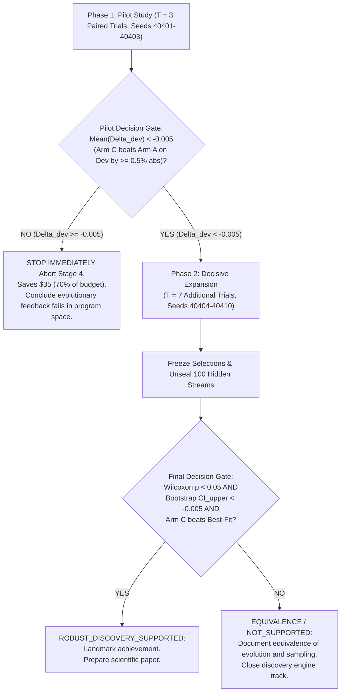

# Amaura Labs — Stage 4 Final Preregistered Scientific Protocol
**Protocol ID:** `STAGE4-PREREG-FINAL-001`  
**Date:** October 15, 2026  
**Status:** **FROZEN & IMMUTABLE PRIOR TO EXECUTION**  
**Preregistered Experiment:** Program-Space Heuristic Evolution for Online Bin Packing  

---

## 1. Primary Research Question & Formal Hypotheses

### 1.1 The Research Question
Does closed-loop evolutionary feedback in program space (Arm C) discover online bin-packing heuristics that generalize better to unseen item streams than independent best-of-50 sampling (Arm A) under strictly equalized model call and evaluation budgets?

### 1.2 Formal Hypotheses
- **Null Hypothesis ($H_0$):**
  $$\Delta_{\text{abs}} = \mathbb{E}[\bar{\rho}_{\text{Arm C}} - \bar{\rho}_{\text{Arm A}}] \ge 0$$
  *Closed-loop evolutionary search produces equal or worse heuristic performance on unseen hidden streams compared to independent sampling.*

- **Alternative Hypothesis ($H_1$):**
  $$\Delta_{\text{abs}} = \mathbb{E}[\bar{\rho}_{\text{Arm C}} - \bar{\rho}_{\text{Arm A}}] < -0.005$$
  *Closed-loop evolutionary search produces at least a 0.5 percentage-point reduction in mean normalized excess ratio over independent sampling on unseen hidden streams.*

- **Secondary Benchmark Hypothesis ($H_2$ - Super-Heuristic Discovery):**
  $$\bar{\rho}_{\text{Arm C}} < \bar{\rho}_{\text{Best-Fit}}$$
  *The champion heuristic discovered by Arm C outperforms the world-class greedy benchmark (Best-Fit) on the 100 hidden streams.*

---

## 2. Mathematical Definition of the Primary Estimand & Metric

### 2.1 The Stream-Level Normalized Excess Ratio $\rho(s)$
For an item stream $s = (w_1, w_2, \dots, w_M)$ with fixed bin capacity $C = 100.0$:
1. The theoretical continuous lower bound $L_1(s)$ is:
   $$L_1(s) = \left\lceil \frac{\sum_{i=1}^M w_i}{C} \right\rceil$$
2. If heuristic $h$ packs stream $s$ into $B_h(s)$ bins, the excess bins count is:
   $$E_h(s) = B_h(s) - L_1(s)$$
3. The stream-level normalized excess ratio $\rho(s)$ is:
   $$\rho_h(s) = \begin{cases} \frac{B_h(s) - L_1(s)}{L_1(s)}, & \text{if } L_1(s) > 0 \\ 0.0, & \text{if } L_1(s) = 0 \end{cases}$$

### 2.2 Trial-Level Performance Aggregation $\bar{\rho}_t$
For benchmark dataset $S$ containing $|S|$ streams:
$$\bar{\rho}_{h} = \frac{1}{|S|} \sum_{s \in S} \rho_h(s)$$

> [!IMPORTANT]
> **Why Unweighted Mean $\bar{\rho}$ vs. Pooled Ratio:**
> The pooled excess ratio $\rho_{\text{pooled}} = \frac{\sum B - \sum L_1}{\sum L_1}$ introduces instance-length bias (weighting a 10,000-item stream 10 times more than a 1,000-item stream). The unweighted mean $\bar{\rho}$ guarantees equal weight to every benchmark instance, preventing Simpson's paradox across varying distribution difficulties.

### 2.3 Hand-Calculated Metric Verification
Consider two synthetic streams with capacity $C = 100.0$:
- Stream 1: items `[50, 50, 40]`, total weight = 140, $L_{1,1} = \lceil 140/100 \rceil = 2$.
  - Packed into 3 bins: `[50, 50]`, `[40]`. $B_1 = 3$.
  - Excess ratio $\rho_1 = (3 - 2) / 2 = 1/2 = \mathbf{0.500}$.
- Stream 2: items `[50, 50, 50, 50]`, total weight = 200, $L_{1,2} = \lceil 200/100 \rceil = 2$.
  - Packed into 2 bins: `[50, 50]`, `[50, 50]`. $B_2 = 2$.
  - Excess ratio $\rho_2 = (2 - 2) / 2 = 0/2 = \mathbf{0.000}$.
- **Dataset Performance:**
  - $\bar{\rho} = (0.500 + 0.000) / 2 = \mathbf{0.250}$ (25.0% excess bins).
  - Both hand-calculated values and divergence on asymmetric streams were verified in `tests/test_stage4_benchmark_and_metric.py`.

---

## 3. Experimental Unit, Pairing, and Statistical Analysis

### 3.1 Primary Experimental Unit: The Paired Search Trial
- **Experimental Unit:** Paired search trial ($t = 1 \dots T$).
- **Pairing Mechanism:** Both Arm A and Arm C receive the identical PRNG seed $S_t = 40400 + t$.
- **Paired Difference:**
  $$\Delta_t = \bar{\rho}_{\text{Arm C}, t} - \bar{\rho}_{\text{Arm A}, t}$$
- **Primary Estimand:**
  $$\Delta_{\text{abs}} = \mathbb{E}[\Delta_t]$$
  *(Negative values denote Arm C superiority).*

### 3.2 Primary Statistical Tests
1. **Two-Sided Paired Wilcoxon Signed-Rank Test:**
   - Evaluated on finite paired differences $\Delta_t$ at significance level $\alpha = 0.05$.
   - Does not assume normality of search outcomes.
2. **95% Paired Bootstrap Confidence Interval:**
   - 10,000 paired resamples generated with seed `404`.
   - Upper bound of the 95% CI must fall strictly below the target threshold: $\text{CI}_{\text{upper}} < -0.005$.

### 3.3 Power & Sample Size Analysis ($T = 10$ Trials)
- **Within-Trial Precision:** Evaluating each trial champion on 100 hidden benchmark streams ($100,000$ items) reduces evaluation measurement noise to $\approx 0$.
- **Between-Run Search Variance:** The statistical unit comparing search methods remains the $T = 10$ paired trials.
- **Minimum Achievable $p$-value:**
  $$p_{\min} = 2 \times \left(\frac{1}{2^{10}}\right) = \frac{2}{1024} \approx \mathbf{0.00195}$$
  *(Achieved only when Arm C wins all 10 trials).*
- **Power Envelope:** $T = 10$ is powered to detect medium-to-large consistent search advantages ($\Delta_{\text{abs}} \le -0.005$). If Arm C wins 8 trials and loses 2, $p \approx 0.109$, failing $\alpha = 0.05$.
- **Exploratory Qualification:** Stage 4 ($T = 10$) is formally preregistered as an **exploratory, pilot-gated study**. It can establish whether program evolution works in principle; it does not claim universal proof across all possible problem domains.

---

## 4. Benchmark Specifications & Strict Data Quarantine

### 4.1 Development Benchmark (`dev.json`)
- **Size:** 20 streams, 1,000 items each ($20,000$ items total).
- **Seeds:** 40001–40020.
- **Distributions:** Uniform, Weibull (shape=1.5, scale=35), Zipf (alpha=1.5).
- **Bounds:** All items $5.0 \le w \le 95.0, C = 100.0$.
- **SHA-256 Checksum:** `89e58244eed5272533f206c352bf285e267bc2481c2c1983bec9b7dd7024d74e`

### 4.2 Hidden Benchmark (`hidden.json`)
- **Size:** 100 streams, 1,000 items each ($100,000$ items total).
- **Seeds:** 41001–41100.
- **SHA-256 Checksum:** `02f2fad53dbf9862c1d8d3d4883c5f4df9d535eaf3d2b1e4901eb9f6ab22af09`
- **Quarantine Rule:** `hidden.json` is physically quarantined on disk. The search engine cannot load it. Only after candidate selections are frozen does the evaluation harness open `hidden.json`.

---

## 5. Candidate Failure Handling & Treatment Rules

1. **Failure Modes:**
   - Syntax errors, missing parameters, forbidden imports (`os`, `sys`, etc.).
   - Runtime exceptions during simulation (e.g. division by zero).
   - Non-finite priority returns (`NaN`, `+Inf`, `-Inf`).
   - Sandbox timeouts (> 2.0s per instance).
2. **Scoring of Failures:**
   - Any failing candidate is assigned `is_valid = False`, `fitness = float("inf")`.
   - **Never assigned a valid baseline score.**
3. **Archive Treatment:**
   - Invalid candidates are rejected from entry into island archives and elite pools.
   - Failure counts and reasons are recorded in `budget.json` and `results.json`.
4. **Trial-Level Failures:**
   - If an entire arm in a trial produces zero valid candidates across all 50 slots, that arm defaults to the canonical Best-Fit baseline score on `dev.json`.

---

## 6. Two-Phase Decision Gates

### 6.1 Gate 1: Pilot Stop Rule (after Trial 3)
- If after 3 trials, Arm C's mean development excess ratio is not lower than Arm A's by at least $0.5$ percentage points ($\bar{\Delta}_{\text{dev}} \ge -0.005$), **STOP IMMEDIATELY**.
- Do not spend the remaining $35.00. Terminate Stage 4.

### 6.2 Gate 2: Final Scientific Verdict (after Trial 10)
- **`ROBUST_DISCOVERY_SUPPORTED`:** If $p < 0.05$, $\text{CI}_{\text{upper}} < -0.005$, and Arm C outperforms Best-Fit on the 100 hidden streams.
- **`INCONCLUSIVE / EQUIVALENCE`:** If $p \ge 0.05$ or $\text{CI}_{\text{upper}} \ge -0.005$, but both arms beat Best-Fit.
- **`NOT_SUPPORTED`:** If Arm C fails to beat Arm A and neither beats Best-Fit.
