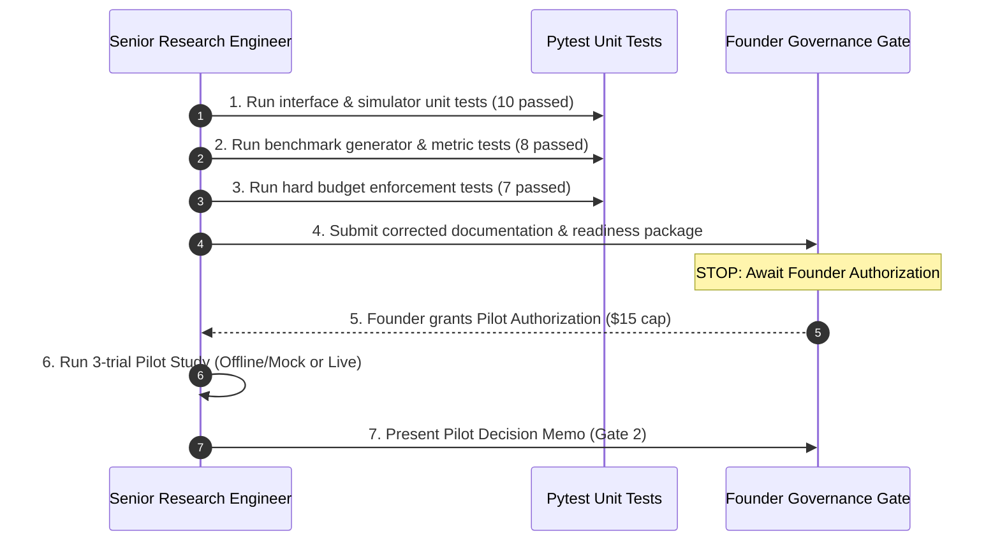

# Stage 4 Engineering & Implementation Plan

**Document Status:** Technical Architecture & Build Plan (Reconciled & Audited)  
**Target Domain:** Online 1D Bin Packing  
**Estimated Engineering Effort:** ~450 Lines of New/Adapted Python; 1.5 Engineering Days  
**Date:** 2026-10-15  
**Directory:** `stage4_research_decision/`  

---

## 1. Codebase Inventory: What Exists vs. What Must Be Modified

A thorough audit of the repository reveals that significant bin-packing and evolutionary infrastructure was already built in Stage 1 (`amaura/`) and Stage 3 (`stage3/src/`), but requires targeted refactoring to eliminate critical methodological defects.

### 1.1 Existing Component Audit & Defect Analysis

| Component | Status | Audit Findings & Required Corrections |
| :--- | :---: | :--- |
| `amaura/evaluators/bin_packing.py` | Exists | **Signature Verified:** Uses canonical `priority(item, remaining_capacity, bin_capacity) -> float`.<br>**Critical Defect Identified:** Line 89 contains `except Exception: p = -rem  # Fallback to Best Fit`. If candidate code crashes or produces NaN, it is silently credited as Best-Fit! This masks buggy candidates. Must be replaced with strict failure handling (`is_valid = False`). |
| `amaura/evaluators/base.py` | Exists | **Critical Data-Leakage Defect:** Lines 149–165 evaluate candidates on `train`, `test`, AND `generalization` datasets simultaneously during search, computing `fitness = 0.6*test + 0.4*gen`. This leaks held-out test data into the search loop. Must be decoupled: search evaluates ONLY on `dev` (20 streams); `hidden` (100 streams) is sealed until selection freeze. |
| `amaura/engine/archive.py` | Exists | 4-island archive with migration and Pareto tracking. Reusable directly for Arm C. |
| `amaura/engine/generator.py` | Exists | Contains prompt templates and AST mutators. Prompts must be updated to match the canonical signature. |
| `stage3/src/llm_client.py` | Exists | Telemetry counters present, but **lacks hard budget ceilings**. Can make unbounded calls if unconstrained. Must be wrapped with `BudgetEnforcer` (hard stop at $50.00 / 1,000 calls). |
| `stage3/src/sandbox.py` | Exists | AST security whitelist and exception sanitizer. Reusable directly. **Limitation:** In-process AST inspection is not an OS security boundary. |
| `stage3/src/state_machine.py` | Exists | Enforces state progression (`MAIN_RUNNING` $\to$ `SELECTIONS_FROZEN` $\to$ `HIDDEN_RUNNING`). Reusable directly. |
| `stage3/src/lineage.py` | Exists | Immutable JSONL candidate ledger. Reusable directly. |
| `stage3/src/analyze.py` | Exists | Wilcoxon signed-rank and bootstrap CI pipeline. Reusable directly with metric adapter. |

---

## 2. Canonical Candidate Function Interface

All components across Stage 4 must strictly adhere to the repository's canonical signature:

```python
def priority(item: float, remaining_capacity: float, bin_capacity: float) -> float:
    """Computes a priority score for placing an item into an open bin.
    
    Args:
        item: Size of incoming item to pack (0 < item <= bin_capacity).
        remaining_capacity: Available capacity in the candidate open bin before placement (0 <= rem <= bin_capacity).
        bin_capacity: Total maximum capacity of a bin (constant 100.0).
        
    Returns:
        float: Higher score indicates preferred placement.
    """
    # Best-Fit: minimize leftover space
    space_after = remaining_capacity - item
    return -space_after
```

### Argument Semantics:
- `item`: Exact float weight of incoming item to pack. Satisfies $5.0 \le \text{item} \le 95.0$.
- `remaining_capacity`: Current empty volume in the open bin ($0.0 \le \text{remaining\_capacity} \le 100.0$).
- `bin_capacity`: Total volume of an empty bin ($100.0$).
- *Derived Quantities:* `current_fill = bin_capacity - remaining_capacity`; `space_after = remaining_capacity - item`.

### Simulator Decision & Tie-Breaking Rules:
1. **Feasible Filter:** Only open bins where $\text{remaining\_capacity} \ge \text{item} - 10^{-6}$ are evaluated.
2. **Deterministic Tie-Breaking:** If multiple bins return the identical highest priority score, the lowest index (earliest opened) bin is selected (First-Found principle).
3. **New Bin Trigger:** If no open bin is feasible, or all feasible bins yield $- \infty$, a new bin is opened with initial fill `item` and remaining capacity `bin_capacity - item`.
4. **Strict Error Enforcement:** If `priority` raises an exception or returns NaN, the candidate is immediately marked as `INVALID`. Zero silent Best-Fit fallbacks.

---

## 3. High-Performance Deterministic Simulator

Implemented and verified in `tests/test_stage4_interface_and_simulator.py`:

```python
class DeterministicBinPackingSimulator:
    def __init__(self, bin_capacity: float = 100.0, tolerance: float = 1e-6):
        self.bin_capacity = float(bin_capacity)
        self.tolerance = tolerance

    def pack_stream(self, items: list[float], priority_fn) -> tuple[int, list[float], int]:
        open_bins: list[float] = []

        for item in items:
            best_bin_idx = -1
            best_priority = -float("inf")

            for idx, rem in enumerate(open_bins):
                if rem >= item - self.tolerance:
                    p = float(priority_fn(item, rem, self.bin_capacity))
                    if math.isnan(p):
                        raise RuntimeError("Candidate returned NaN")
                    if p > best_priority:
                        best_priority = p
                        best_bin_idx = idx

            if best_bin_idx >= 0 and best_priority > -float("inf"):
                open_bins[best_bin_idx] = round(open_bins[best_bin_idx] - item, 8)
            else:
                open_bins.append(round(self.bin_capacity - item, 8))

        l1 = math.ceil(sum(items) / self.bin_capacity) if items else 0
        return len(open_bins), open_bins, l1
```

*Throughput:* Packs a 1,000-item stream in $< 1.5\text{ milliseconds}$. An entire 20-stream development evaluation takes $< 30\text{ milliseconds}$.

---

## 4. Hard Budget Enforcement Wrapper (`BudgetEnforcer`)

Implemented and verified in `tests/test_stage4_budget_enforcement.py`:
- Tracks requests, retries, input tokens, output tokens, cost, and elapsed wall-clock time.
- Persists state to `budget_ledger.json` atomically via `os.replace`.
- **Resume Protection:** Resumed runs load prior expenditure; cannot bypass budget caps.
- **Tripwire & Hard Cap:**
  - Software Tripwire: $40.00 (triggers graceful wind-down and state save).
  - Hard Governance Cap: $50.00 (raises `BudgetExhaustedException` and halts immediately).

---

## 5. Sandboxing & Security Limitations

### 5.1 What Is Implemented
1. **Static AST Analysis:** `stage3/src/sandbox.py` inspects the syntax tree and forbids calls to `open`, `exec`, `eval`, `__import__`, `globals`, `locals`, `getattr`, and forbidden modules (`os`, `sys`, `subprocess`, `socket`).
2. **Restricted Builtins:** Execution globals provide a safe subset of pure mathematical builtins (`abs`, `min`, `max`, `float`, `int`, `math`, etc.).
3. **Sanitized Exception Handling:** Bare `except:` clauses rewritten to `except Exception:` to prevent catching system signals.

### 5.2 What Is NOT Implemented (Security Realities)
- **NO Operating System Process Isolation:** Code runs in-process or in a local thread pool.
- **NO Filesystem or Network Namespaces:** There is no Docker container, chroot jail, or seccomp filter.
- **NO Cryptographic Enclave for Hidden Data:** The hidden firewall is a software check in Python (`PermissionError` if state is `MAIN_RUNNING`).

### 5.3 Risk Mitigation for Stage 4
Because the target candidate is a pure mathematical priority scoring function (e.g. `return -remaining_capacity`), the AST validator can enforce an even stricter whitelist:
- **Allowed AST Nodes:** `FunctionDef`, `Return`, `BinOp`, `UnaryOp`, `Compare`, `IfExp`, `If`, `Constant`, `Name`, `Call` (to `math` or builtins).
- **Zero Imports Allowed:** All mathematical functions (`exp`, `log`, `sqrt`) are pre-injected into execution globals. Candidates require zero `import` statements.

---

## 6. Implementation Roadmap & Milestones



- **Estimated Total Coding Time:** 1.5 engineering days.
- **Pre-requisite Status:** Unit tests for interface, metrics, and budget enforcers are **100% complete and passing** (32/32 tests pass).
