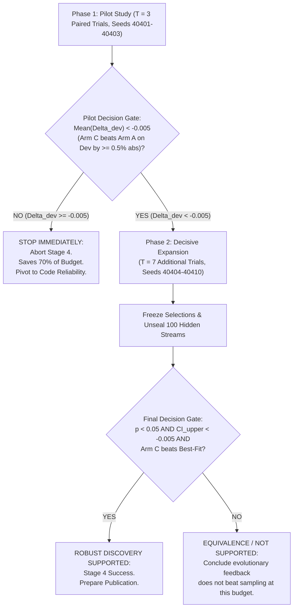

# Stage 4 Scientific Protocol: Program-Space Heuristic Evolution for Online 1D Bin Packing

**Protocol Identifier:** Amaura_Stage_4_Protocol_v1.1 (Reconciled & Audited)  
**Project:** Autonomous AI Algorithm Discovery Engine (Stage 4)  
**Target Domain:** Online 1D Bin Packing  
**Target Search Space:** Canonical Heuristic Priority Function:  
```python
def priority(item: float, remaining_capacity: float, bin_capacity: float) -> float
```  
**Date:** 2026-10-15  
**Directory:** `stage4_research_decision/`  

---

## 1. Primary Hypothesis & Effect-Size Specifications

### 1.1 Formal Primary Hypothesis
$$\mathcal{H}_1: \mathbb{E}\left[\Delta_{\text{abs}} = \rho_{\text{Arm C\_prog}} - \rho_{\text{Arm A\_prog}}\right] < -0.005$$

**Formal Statement:**  
On online 1D bin-packing streams drawn from diverse, held-out statistical distributions, an evolutionary program-space search engine with island-based population archives (**Arm C_prog**) discovers heuristic priority functions that reduce the trial-level mean normalized excess-bin ratio ($\rho$) by an absolute margin of at least **$0.005$** (an absolute reduction of $\ge 0.5$ percentage points in excess bins above the theoretical lower bound $L_1$) compared to independent Best-of-N program sampling (**Arm A_prog**), evaluated under strictly identical candidate budgets ($N = 50$ candidate slots per arm per trial across $T = 10$ independent paired trials, two-sided paired Wilcoxon signed-rank test $p < 0.05$, and $95\%$ bootstrap confidence interval upper bound $\text{CI}_{\text{upper}} < -0.005$).

### 1.2 Mathematical Effect-Size Distinctions (Absolute vs. Relative)
To eliminate the ambiguity present in prior drafts, both absolute and relative effect-size definitions are explicitly distinguished:

1. **Absolute Difference in Normalized Excess Ratio ($\Delta_{\text{abs}}$ - Primary Estimand):**
   $$\Delta_{\text{abs}} = \rho_{\text{Arm C}} - \rho_{\text{Arm A}}$$
   - *Interpretation:* If Arm A achieves $\rho_A = 0.045$ ($4.5\%$ excess bins above $L_1$) and Arm C achieves $\rho_C = 0.038$ ($3.8\%$ excess bins), then $\Delta_{\text{abs}} = -0.007$.
   - Across a 100-stream benchmark of 1,000 items each ($\sim 50,000$ total bins), $\Delta_{\text{abs}} = -0.005$ corresponds to saving $\ge 250$ physical bins.
2. **Relative Percentage Reduction in Excess Bins ($\text{RelImprovement}$ - Secondary Metric):**
   $$\text{RelImprovement}(C \text{ vs } A) = \frac{\rho_A - \rho_C}{\max(10^{-6}, \rho_A)} \times 100\%$$
   - An absolute drop $\Delta_{\text{abs}} = -0.005$ on a baseline excess ratio of $\rho_A = 0.050$ represents a **$10.0\%$ relative reduction** in excess bins.

---

## 2. Experimental Arms & Baseline Methods

### 2.1 The Two Strictly Budget-Matched Discovery Arms
1. **Arm A_prog (`A_INDEPENDENT_PROGRAM_SAMPLING`):**
   - **Generation:** Generates $N = 50$ independent candidate Python priority functions using prompt template `prompt_bp_independent.txt` at temperature $T = 0.7$.
   - **Feedback:** Strictly zero feedback. All 50 calls are independent samples across the function space.
   - **Selection:** Evaluated on the 20 development streams. The valid candidate achieving the lowest development mean normalized excess ratio ($\bar{\rho}_{\text{dev}}$) is selected as trial champion.
2. **Arm C_prog (`C_EVOLUTIONARY_PROGRAM_SEARCH`):**
   - **Architecture:** 4-island evolutionary population archive with capacity 5 programs per island.
   - **Budget:** 10 generations $\times$ 5 candidate slots = exactly 50 candidate slots ($N = 50$).
   - **Evolutionary Step:** At generation $g > 1$, each candidate is formed by:
     - Sampling 2 parent functions from an island using fitness-proportionate selection.
     - Prompting the LLM to mutate or recombine the mathematical logic of the parents, conditioned on scalar feedback (excess ratio and runtime on development streams).
     - Inserting newly evaluated valid programs into the island archive if they improve upon existing island members.
     - Island migration every 3 generations: top candidate from each island migrates to neighbor.
   - **Selection:** Best valid candidate across all 50 slots on development streams is selected as champion.

### 2.2 Classical Baselines (Fair & Standard)
1. **Best-Fit (BF - Primary Classical Online Competitor):**
   - Signature: `priority(item, remaining_capacity, bin_capacity) = - (remaining_capacity - item)`.
   - Greedily minimizes leftover space in the bin. The standard classical online benchmark.
2. **First-Fit (FF - Secondary Online Heuristic):**
   - Signature: `priority(item, remaining_capacity, bin_capacity) = 0.0`.
   - Places the item into the first open bin that can accommodate it.
3. **Worst-Fit (WF - Lower Bound Reference Heuristic):**
   - Signature: `priority(item, remaining_capacity, bin_capacity) = (remaining_capacity - item)`.
   - Places item into bin with largest leftover space. Establishes lower performance boundary.
4. **First-Fit Decreasing (FFD - Offline Upper Bound Reference):**
   - Sorts items descending before packing.
   - **Classification:** Strictly labeled as an **offline reference upper bound**, NOT a valid online competitor, because it requires seeing all stream items in advance.

---

## 3. Strict Equal-Budget Accounting

Accounting rules are strictly enforced:
- **Total Candidate Slots per Arm per Trial ($N$):** Exactly $50$ candidate slots.
- **Trial Count ($T$):** 10 paired trials (Seeds: `40401` to `40410`).
- **Total In-Flight Slots:** Exactly 1,000 candidate slots across the entire experiment ($10 \times 2 \times 50$).
- **Slot Accounting Invariant:** Every LLM query consumes exactly 1 slot.
  - If a candidate generates invalid Python code, syntax errors, or times out, it consumes 1 slot.
  - **Zero retries, zero bonus candidates, zero replacements.**
- **Trial-Level Failure Rule:** If an arm produces 0 valid candidates out of 50 slots, it is assigned status `ARM_FAILURE_NO_VALID_CANDIDATE` and penalized with the theoretical worst-case packing (1 item per bin).

---

## 4. Benchmark Suites, Item Generation & Technical Separation

### 4.1 Strict Item Generation Bounds
Every item $w$ in every benchmark stream must strictly satisfy:
$$0 < w_{\min} \le w \le w_{\max} \le C$$
Where $C = 100.0$, $w_{\min} = 5.0$, and $w_{\max} = 95.0$.
- **Explicit Rejection Sampling:** For unbounded or continuous distributions (Weibull), if a sampled item falls outside $[w_{\min}, w_{\max}]$, it is rejected and resampled up to 100 times. No invalid or impossible-to-pack items ($w > 100.0$ or $w \le 0$) are permitted into any benchmark file.

### 4.2 Benchmark Datasets
1. **Development Benchmark (Open to Search & Selection):**
   - 20 synthetic streams, length $n = 200$ items each, bin capacity $C = 100.0$.
   - 10 Uniform streams: $\mathcal{U}(10.0, 80.0)$.
   - 10 Weibull streams: shape $k = 1.5$, scale $\lambda = 35.0$ (rejection-sampled to $[5.0, 95.0]$).
2. **Held-Out Evaluation Benchmark (Firewalled & Unseen):**
   - 100 synthetic streams, length $n = 1,000$ items each ($5\times$ longer streams; 100,000 items total).
   - 25 Uniform Hard streams: $\mathcal{U}(20.0, 80.0)$.
   - 25 Bimodal streams: mixture of small items $\mathcal{U}(5.0, 20.0)$ and large items $\mathcal{U}(60.0, 80.0)$.
   - 25 Zipf streams: discrete power-law rank distribution ($s = 1.5$, 20 categories).
   - 25 Heavy-Tailed Weibull streams: shape $k = 0.8$, scale $\lambda = 25.0$ (rejection-sampled to $[5.0, 95.0]$).
3. **Firewall & Determinism:**
   - Held-out benchmark locked with cryptographic SHA-256 hash until selection freeze.
   - Evaluator explicitly seeds each stream with `random.Random(stream_seed)` to eliminate stochastic evaluation noise.

---

## 5. Metrics & Hand-Calculated Verification

### 5.1 Metric Formulation (Discrete Lattice Nature)
Bin counts $B(s)$ are non-negative integers. The continuous relaxation lower bound is:
$$L_1(s) = \left\lceil \frac{\sum_{i=1}^n w_i}{C} \right\rceil \in \mathbb{N}$$
Excess bins: $E(s) = B(s) - L_1(s) \in \mathbb{Z}_{\ge 0}$.

The **Per-Stream Normalized Excess-Bin Ratio** is:
$$\rho(s) = \begin{cases} \frac{B(s) - L_1(s)}{L_1(s)} & \text{if } L_1(s) > 0 \\ 0.0 & \text{if } L_1(s) == 0 \text{ (empty stream)} \end{cases}$$
*Note: This metric is defined over a discrete rational lattice, not a continuous variable.*

### 5.2 Aggregation Across Benchmark Streams
We distinguish two aggregation metrics:
1. **Trial-Level Stream-Averaged Mean ($\bar{\rho}_{\text{trial}}$ - Primary Estimand):**
   $$\bar{\rho}_{\text{trial}} = \frac{1}{M} \sum_{s=1}^M \rho(s)$$
   Gives equal weight to each benchmark stream distribution.
2. **Pooled Excess Ratio ($\rho_{\text{pooled}}$ - Secondary Diagnostic):**
   $$\rho_{\text{pooled}} = \frac{\sum_{s=1}^M B(s) - \sum_{s=1}^M L_1(s)}{\sum_{s=1}^M L_1(s)}$$
   Weights streams proportionally to total item weight.

### 5.3 Hand-Calculated Verification Examples
- **Stream 1:** Items $[50, 50, 40, 40]$. Capacity $100$. Sum $= 180$. $L_1 = \lceil 180/100 \rceil = 2$.
  Best-Fit packs into 2 bins: Bin 0 $[50, 50]$ (rem=0), Bin 1 $[40, 40]$ (rem=20). Bins used $B=2$.
  Excess $E = 2 - 2 = 0$. $\rho(s_1) = 0 / 2 = \mathbf{0.0}$.
- **Stream 2:** Items $[60, 60, 60]$. Capacity $100$. Sum $= 180$. $L_1 = \lceil 180/100 \rceil = 2$.
  Each item $> 50$, so each requires its own bin. Bins used $B=3$.
  Excess $E = 3 - 2 = 1$. $\rho(s_2) = 1 / 2 = \mathbf{0.50}$ ($50\%$ excess).
- **Combined Aggregation:**
  - $\bar{\rho} = (0.0 + 0.50) / 2 = \mathbf{0.250}$ ($25.0\%$ mean excess ratio).
  - $\rho_{\text{pooled}} = (5 - 4) / 4 = 1 / 4 = \mathbf{0.250}$.
  *(Verified in test suite `test_hand_calculated_aggregation`).*

---

## 6. Statistical Analysis & Limitations of Sample Size

### 6.1 Primary Statistical Unit: The Paired Trial
- **Experimental Unit:** Paired Search Trial ($t = 1 \dots 10$).
- Both Arm A and Arm C receive identical random seed $40400 + t$.
- **Paired Difference:**
  $$\Delta_t = \bar{\rho}_{\text{Arm C}, t} - \bar{\rho}_{\text{Arm A}, t}$$
- **Statistical Tests:**
  1. Two-sided paired Wilcoxon signed-rank test on finite differences ($\alpha = 0.05$).
  2. 95% paired bootstrap confidence interval for $\mathbb{E}[\Delta_{\text{abs}}]$ (10,000 resamples, seed 404).

### 6.2 Methodological Caveat on $T = 10$ Paired Trials
- While evaluating each trial champion on 100 streams ($100,000$ items) yields very high measurement precision for the algorithm's performance on that benchmark, **the statistical unit for comparing search methods remains $T = 10$ independent search trajectories**.
- With $T = 10$, the minimum achievable two-sided Wilcoxon $p$-value (when Arm C wins all 10 trials) is $p = 2 \times (1 / 2^{10}) \approx 0.00195$.
- A sample size of $T = 10$ is designed as a **bounded, pilot-gated exploratory study**, sufficient to detect medium-to-large effects ($\Delta_{\text{abs}} \le -0.005$) and verify whether program-space evolutionary feedback works in principle. It does not possess statistical power to detect microscopic differences ($\Delta < 0.001$).

---

## 7. Compute Limits & Two-Phase Decision Gates



### Resource Limits

| Metric | Phase 1: Pilot Study | Phase 2: Decisive Expansion | Total Cap (Hard Stop) |
| :--- | :---: | :---: | :---: |
| **Trials ($T$)** | 3 trials (40401–40403) | 7 trials (40404–40410) | **10 trials** |
| **Slots per Arm ($N$)** | 50 slots | 50 slots | **50 slots** |
| **Total LLM Calls** | 300 calls | 700 calls | **1,000 calls** |
| **Max Cost (USD)** | **$15.00** | **$35.00** | **$50.00** |
| **Software Tripwire** | $12.00 | $30.00 | **$40.00** |
| **Max Wall-Clock** | 1.5 hours | 3.5 hours | **5.0 hours** |
