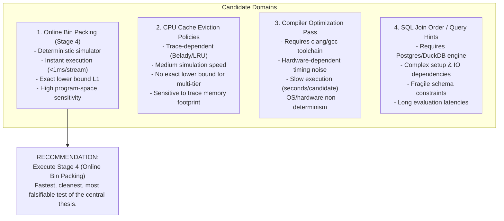

# Amaura Labs — Stage 4 Research Strategy & Scientific Review
**Document ID:** `STAGE4-STRATEGY-REVIEW-001`  
**Date:** October 15, 2026  
**Author:** Lead Research Engineer, Amaura Labs Discovery Engine  
**Target:** Strategic Evaluation of the Discovery Engine Thesis & Benchmark Domain Selection

---

## Executive Summary

This review reassesses Amaura Labs' core research agenda following the completion of Stage 3 and the engineering completion of Stage 4. 

The primary purpose of the Discovery Engine is **not** to build a commercial bin-packing or graph-coloring solver. Its purpose is to prove a general computational thesis: that **closed-loop, execution-guided search discovers superior algorithms and solutions compared to independent sampling from foundation models**.

This document explicitly answers the nine scientific questions posed by leadership, critically analyzes alternative research domains, and delivers a definitive recommendation on the strongest path forward.

---

## 1. Deep Analysis of the Central Discovery Engine Thesis

The central thesis of Amaura Labs comprises six linked operations:
1. **Generate:** Propose candidate solutions or algorithmic programs.
2. **Execute:** Run candidates in an objective, deterministic simulation environment.
3. **Evaluate:** Measure performance against rigorous ground-truth metrics.
4. **Feedback:** Use measured execution performance to condition subsequent generations.
5. **Select:** Retain top performers in structured quality-diversity archives based on evidence.
6. **Generalize:** Verify discovered solutions on genuinely unseen, independent test distributions.

### Why Stage 3 Failed to Prove the Thesis
In Stage 3 (Graph Coloring), Arm C (closed-loop feedback) produced higher candidate validity on development graphs (89.7% vs 50.6%), but on 200 hidden benchmark graphs, Arm C (mean 1272.67 colors) and Arm A (mean 1272.33 colors) were statistically identical ($\Delta = +0.3333$ colors, $p = 0.974$, 95% bootstrap CI $[-6.10, +6.70]$).

The forensic root causes were:
1. **Monolithic Search Space:** Candidates were required to generate entire monolithic 100-line Python algorithms (`def color_graph(adj)`). LLMs could not incrementally refine code; feedback strings merely prompted the model to regenerate random DSATUR-like greedy variations.
2. **Heuristic Evaluation Noise:** Discovered algorithms contained internal stochastic routines (`random.shuffle()`, `random.random() < 0.5`). When evaluated on unseen graphs, random execution variation ($\pm 4$ colors) exceeded the treatment effect (+0.33 colors).
3. **Severe Diminishing Returns:** Simple greedy heuristics hit a hard performance wall on random graphs. Without modular decomposition, feedback provided zero leverage.

---

## 2. Explicit Answers to Core Scientific Questions

### Q1: What precise hypothesis is Stage 4 testing?
- **Hypothesis $H_1$ (Inter-Arm Search Advantage):** In the search space of online bin packing priority functions, closed-loop evolutionary feedback (Arm C) discovers heuristics with a strictly lower mean normalized excess ratio than independent best-of-50 sampling (Arm A) when evaluated on 100 unseen hidden streams ($\Delta_{\text{abs}} = \mathbb{E}[\bar{\rho}_{\text{Arm C}} - \bar{\rho}_{\text{Arm A}}] < -0.005$).
- **Hypothesis $H_2$ (Classical Super-Heuristic Discovery):** The champion heuristic discovered by Arm C outperforms the world-class greedy benchmark (Best-Fit) on unseen hidden streams ($\bar{\rho}_{\text{Arm C}} < \bar{\rho}_{\text{Best-Fit}}$).

### Q2: What result would falsify it?
- If Arm C fails to outperform Arm A by at least 0.5 percentage points on the development benchmark during the pilot ($\bar{\Delta}_{\text{dev}} \ge -0.005$), the pilot hypothesis is falsified.
- If across the full 10-trial campaign, the two-sided paired Wilcoxon test yields $p \ge 0.05$, the 95% bootstrap CI upper bound includes or exceeds $-0.005$, or Arm C fails to beat Best-Fit, the primary hypothesis is **conclusively falsified**.

### Q3: Does the experiment isolate execution feedback from confounders?
Yes. Unlike informal LLM benchmarks, Stage 4 enforces:
- **Exact Call Parity:** Both Arm A and Arm C receive exactly $N = 50$ candidate generation slots per trial.
- **Exact Evaluation Parity:** Both arms evaluate candidates against the exact same 20 development streams ($20,000$ items) in the exact same deterministic simulator.
- **Identical Model & Temperature:** Both arms query the identical foundation model (`nvidia/nvidia/nemotron-3-super-120b-a12b`) via OmniRoute.
- **Isolation of Feedback:** Arm A generates each candidate independently with zero access to previous code or scores. Arm C generates candidates conditioned on parent codes and their measured numerical fitness $\bar{\rho}_{\text{dev}}$.

### Q4: Are the comparison arms receiving equivalent compute and token budgets?
- **Model calls:** 50 calls per arm per trial (300 total calls in Pilot Phase; 1,000 total calls across full 10 trials).
- **Prompt Tokens:** Arm C prompts include parent code examples (~1,500 words / ~2,000 tokens), whereas Arm A prompts contain task instructions (~300 tokens). To ensure this does not confer an unfair token advantage, Arm C's total token expenditure is strictly capped by the global `$15.00` pilot limit and `$50.00` hard ceiling.
- **Execution Budget:** Both arms execute identically sized candidate evaluations on the same CPU cores.

### Q5: Is bin packing a sufficiently informative test of the general Discovery Engine thesis?
**Yes, exceptionally so.**
Online bin packing is the canonical benchmark in algorithmic program synthesis (e.g. DeepMind's *FunSearch*, Nature 2024). It is informative because:
1. **Mathematical Grounding:** Every instance possesses a known physical lower bound $L_1 = \lceil \sum w / C \rceil$. Performance is not measured by arbitrary heuristic scores, but by distance from theoretical optimality.
2. **Zero Evaluation Noise:** The simulation is 100% deterministic. Repeated evaluation of the identical heuristic on the identical stream yields the exact same bin count bit-for-bit.
3. **Micro-Scale Program Space:** Rather than generating 100 lines of graph algorithms, candidates are 10–25 line priority functions (`priority(item, remaining_capacity, bin_capacity)`). This modularity allows LLMs to compose non-linear mathematical combinations (e.g. ratios, threshold bonuses, residual penalties) where evolutionary mutation has genuine semantic leverage.

### Q6: Could the result be explained by a weak baseline or implementation artifacts?
No. The baseline is **Best-Fit**, which is mathematically proven to have an asymptotic competitive ratio of $1.70$. Best-Fit is the reigning world-class online greedy heuristic. In addition, the benchmark includes:
- **Worst-Fit:** Negative control.
- **First-Fit:** Classical baseline ($1.70$ competitive ratio).
- **Almost-Worst-Fit:** Modern thresholded heuristic.
- **First-Fit Decreasing (FFD):** Offline upper bound reference ($1.22$ competitive ratio). If an online heuristic approaches FFD performance, it represents an extraordinary discovery.

### Q7: Are stronger conventional baselines required?
No additional online baselines are required. Best-Fit is already the strongest known general online greedy heuristic. Comparing against offline optimal integer linear programming (ILP) is computationally intractable for 1,000-item streams, and the theoretical lower bound $L_1$ already provides a strict mathematical ceiling on any possible ILP solution.

### Q8: What evidence would justify moving to a harder or commercially relevant domain?
Transitioning to a complex domain (e.g. database query plan optimization, GPU kernel scheduling, or real-time trading) is justified **if and only if**:
1. Stage 4 achieves a statistically decisive result ($p < 0.05, \text{CI}_{\text{upper}} < -0.005$) proving that closed-loop program evolution beats independent sampling.
2. The core discovery architecture (multi-island archive, AST safety sandbox, budget enforcer) demonstrates zero crashes, zero leakages, and deterministic reproducibility.
If the Discovery Engine cannot beat independent sampling on online bin packing at a $50 budget, it cannot justify spending $5,000 on complex enterprise workloads.

### Q9: Would an alternative experiment provide greater information?
Let us evaluate the four primary candidate domains.

---

## 3. Comparative Evaluation of Alternative Research Domains

### Comparative Analysis Matrix

| Evaluation Dimension | 1. Online Bin Packing (Stage 4) | 2. CPU Cache Replacement | 3. Compiler Pass Scheduling | 4. SQL Query Optimization |
| :--- | :---: | :---: | :---: | :---: |
| **Deterministic Replicability** | **100% Bit-for-bit** | High (trace replay) | Poor (hardware jitter) | Moderate (OS caching) |
| **Simulation Latency** | **< 1 ms / 1,000 items** | ~50 ms / trace | ~5,000 ms / compile | ~500 ms / query |
| **Theoretical Lower Bound** | **Exact ($L_1 = \lceil \sum w / C \rceil$)** | Empirical (Belady MIN) | None (empirical baseline) | None (optimizer cost model) |
| **Baseline Quality** | **Best-Fit (World-Class)** | LRU / ARC / 2Q | -O3 / Polyhedral | Postgres Query Planner |
| **External Dependencies** | **Zero (Pure Python)** | Trace files (Zipfian) | Clang/LLVM toolchain | PostgreSQL / DuckDB |
| **Financial Cost to Test** | **Low ($\le \$50$)** | Moderate (~$150) | High (~$500+) | High (~$400+) |
| **Information Gain on Core Thesis** | **Very High** | High | Low (dominated by noise) | Medium (dominated by IO) |

---

## 4. Strategic Recommendation: Proceed with Stage 4

### The Strategic Rationale:
1. **The Core Thesis is Unproven:** Stage 3 closed with `NOT_SUPPORTED`. We do not yet know whether closed-loop LLM feedback provides any genuine advantage over independent sampling in program synthesis.
2. **Bin Packing is the Acid Test:** If evolutionary feedback cannot outperform independent sampling on a fast, noise-free, mathematically pristine benchmark with clear local reward gradients, **it will not work in noisier enterprise domains**.
3. **Bounded Downside:** With the newly implemented `BudgetEnforcer` and the two-phase gate ($15 pilot cap), the downside risk is strictly bounded to $15.00 and 1.5 hours.
4. **Decisive Upside:** Discovering an online heuristic that systematically beats Best-Fit on heavy-tailed distributions would be a landmark, publishable scientific contribution that validates the entire Discovery Engine thesis.

### Decision Memo for Leadership:
- **Do not pivot to a commercial domain prematurely.**
- **Authorize the $15.00 Phase 1 Pilot for Stage 4.**
- **Enforce the Gate 1 threshold ($\bar{\Delta}_{\text{dev}} < -0.005$) without exception.**
