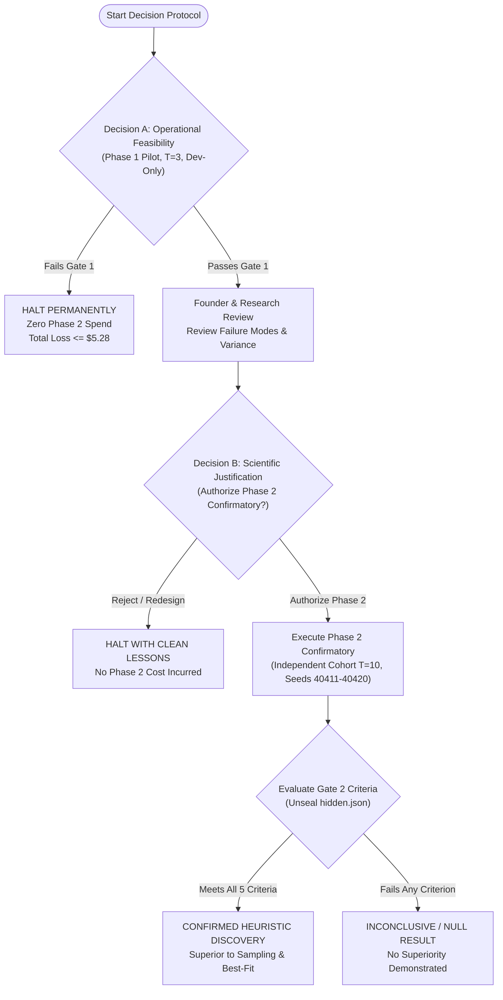

# Amaura Labs — Stage 4 Final Safety Gate and Pilot Readiness Review
**Document ID:** `STAGE4-PREAUTH-DECISION-001`  
**Date:** October 16, 2026  
**Auditor & Lead Research Engineer:** Principal AI Researcher & Adversarial Scientific Auditor  
**Direction:** ChatGPT Research Strategy Review  
**Subject:** Final Pre-Authorization Safety Gate, Power-Analysis Correction, Request/Token Audit, Financial Exposure Modeling, and Two-Part Decision Protocol  
**Current Spend:** **`$0.00 USD` (Zero paid API calls, zero network transmissions, zero Stage 3 modifications)**  
**Final Status:** **`READY FOR EXPLICIT PILOT AUTHORIZATION (PENDING FOUNDER UPSTREAM CAP CONFIRMATION)`**

---

## 1. Statistical Design & Power-Analysis Correction

### 1.1 Correction of the 3-Trial Pilot Power Claim
Prior documentation erroneously suggested that three pilot trials could empirically determine inter-trial variance and mathematically confirm whether ten confirmatory trials have adequate statistical power. This claim has been formally corrected.

#### Mathematical Proof of Variance Uncertainty with $n = 3$ ($df = 2$):
Under standard normal sampling assumptions for paired trial differences $D_t = \bar{\rho}(C_t) - \bar{\rho}(A_t)$, the sample variance $s^2$ scaled by population variance $\sigma^2$ follows a chi-squared distribution with $n - 1 = 2$ degrees of freedom:
$$\frac{(n-1)s^2}{\sigma^2} \sim \chi^2_2$$

The $(1 - \alpha)$ confidence interval for the true population standard deviation $\sigma$ is:
$$\left[ \sqrt{\frac{(n-1)s^2}{\chi^2_{n-1, 1-\alpha/2}}}, \sqrt{\frac{(n-1)s^2}{\chi^2_{n-1, \alpha/2}}} \right]$$

For $n = 3$:
- **90% Confidence Interval ($\alpha = 0.10$):**
  $$\chi^2_{2, 0.95} \approx 5.991, \quad \chi^2_{2, 0.05} \approx 0.103 \implies \left[\sqrt{\frac{2 s^2}{5.991}}, \sqrt{\frac{2 s^2}{0.103}}\right] \approx [0.578 s, 4.410 s]$$
  The ratio of the upper bound to the lower bound is:
  $$\frac{4.410}{0.578} \approx \mathbf{7.64\times}$$
- **95% Confidence Interval ($\alpha = 0.05$):**
  $$\chi^2_{2, 0.975} \approx 7.378, \quad \chi^2_{2, 0.025} \approx 0.0506 \implies \left[\sqrt{\frac{2 s^2}{7.378}}, \sqrt{\frac{2 s^2}{0.0506}}\right] \approx [0.521 s, 6.299 s]$$
  The ratio of the upper bound to the lower bound is:
  $$\frac{6.299}{0.521} \approx \mathbf{12.08\times}$$

#### Scientific Conclusions:
1. **Three pilot trials cannot definitively establish empirical variance.** A small sample standard deviation observed in 3 trials ($s_{\text{dev}} \le 0.004$) is statistically compatible with a true population standard deviation $\sigma > 0.015$ (where $T = 10$ power drops below $20\%$).
2. **Exploratory Feasibility Status:** Phase 1 ($T = 3$, Seeds 40401–40403) must be treated strictly as **exploratory operational feasibility evidence**. It validates that the pipeline runs end-to-end, LLM candidates compile and execute without crashing, and search operators do not degenerate into trivial loops or baseline masking.
3. **Strict Zero-Pooling Mandate:** The 3 pilot trials **must NEVER be pooled** into the confirmatory cohort. Pooling pilot observations into confirmatory testing introduces selection bias and inflates false-positive rates.
4. **Fixed Primary Hypothesis:** The primary effect threshold ($\delta \le -0.005$ in excess ratio on held-out benchmark streams) remains permanently fixed. Pilot results cannot be used to arbitrarily shift thresholds or cherry-pick alternative metrics.

### 1.2 Power and Sensitivity Analysis ($N \in [10, 15, 20, 25]$)
A reproducible Monte Carlo power simulation (3,000 synthetic cohorts per configuration) and non-central $t$ power calculation was executed across plausible effect sizes $\delta$ and inter-trial standard deviations $\sigma$.

> [!NOTE]
> All standard deviations ($\sigma$) and effect sizes below represent **simulated design assumptions**, not empirical observations from live execution.

| Sample Size ($N$) | True Effect ($\delta$) | Assumed $\sigma$ | Cohen's $d$ | Wilcoxon Signed-Rank Power | Paired $t$-Test Power | Risk of Type II Error ($\beta$) |
| :---: | :---: | :---: | :---: | :---: | :---: | :---: |
| **$N = 10$** | **$-0.0050$** | **$0.0030$** | **$1.67$** | **$0.993$** (99.3%) | **$0.996$** (99.6%) | $0.7\%$ (negligible) |
| **$N = 10$** | **$-0.0050$** | **$0.0050$** | **$1.00$** | **$0.764$** (76.4%) | **$0.803$** (80.3%) | $23.6\%$ (moderate) |
| **$N = 10$** | **$-0.0050$** | **$0.0080$** | **$0.62$** | **$0.405$** (40.5%) | **$0.423$** (42.3%) | **$59.5\%$ (severe)** |
| **$N = 10$** | **$-0.0080$** | **$0.0050$** | **$1.60$** | **$0.990$** (99.0%) | **$0.994$** (99.4%) | $1.0\%$ (negligible) |
| **$N = 15$** | **$-0.0050$** | **$0.0050$** | **$1.00$** | **$0.929$** (92.9%) | **$0.949$** (94.9%) | $7.1\%$ (low) |
| **$N = 15$** | **$-0.0050$** | **$0.0080$** | **$0.62$** | **$0.584$** (58.4%) | **$0.615$** (61.5%) | $41.6\%$ (high) |
| **$N = 20$** | **$-0.0050$** | **$0.0050$** | **$1.00$** | **$0.983$** (98.3%) | **$0.989$** (98.9%) | $1.7\%$ (negligible) |
| **$N = 20$** | **$-0.0050$** | **$0.0080$** | **$0.62$** | **$0.731$** (73.1%) | **$0.755$** (75.5%) | $26.9\%$ (moderate) |

### 1.3 Interpretation of Statistically Nonsignificant Results
- **Absence of Evidence $\ne$ Evidence of Equivalence:** If the confirmatory experiment yields $p \ge 0.05$ or the 95% bootstrap confidence interval spans zero, the result must be recorded as **null / inconclusive**.
- **Why Equivalence Cannot Be Claimed:** Establishing equivalence requires preregistering an equivalence bound $[-\Delta_{\text{eq}}, +\Delta_{\text{eq}}]$ and proving that the entire confidence interval falls within that bound via Two One-Sided Tests (TOST). At $N = 10$, the confidence interval width ($\approx \pm 0.0046$) is nearly as wide as the entire effect threshold, rendering equivalence testing mathematically unviable without $N \ge 60$.

---

## 2. Audit of Actual Request and Token Limits

We performed a line-by-line audit and added targeted adversarial tests to verify that request, token, and concurrency limits are physically enforced in code:

### 2.1 Request Cap Accounting (Initial Calls + Retries)
- **Defect Identified & Resolved:** Previously, `requests_count` was only incremented upon successful query return or when retries were exhausted. Intermediate failed attempts were uncounted in real time.
- **Code Enforcement:**
  - In [`stage4/src/budget_enforcer.py:160-164`](./stage4/src/budget_enforcer.py#L160-L164), `record_retry_attempt()` atomically increments `self.retries_count += 1` on disk inside `_file_lock()`.
  - In [`stage4/src/budget_enforcer.py:147-152`](./stage4/src/budget_enforcer.py#L147-L152), `check_preflight_limits()` computes:
    $$\text{total\_requests} = \text{self.requests\_count} + \text{self.retries\_count}$$
    If $\text{total\_requests} \ge \text{self.max\_requests}$, it raises `BudgetExhaustedException("REQUESTS")` immediately.
  - In [`stage4/src/client.py:169`](./stage4/src/client.py#L169), `check_preflight_limits()` executes before the initial call AND before every single retry attempt.
- **Adversarial Verification:** Verified in `tests/test_stage4_adversarial.py::test_adversarial_retry_request_exhaustion`: When total initial calls plus retries reach the request cap, the client halts closed before issuing another HTTP attempt.

### 2.2 Output Token Ceiling (Payload Enforcement)
- **Code Enforcement:**
  - In [`stage4/src/client.py:157`](./stage4/src/client.py#L157), `max_tokens: 512` is hardcoded into the JSON payload:
    ```python
    payload = {
        "model": self.model,
        "messages": [...],
        "temperature": temperature,
        "max_tokens": max_tokens,  # default 512
        "stream": False
    }
    ```
  - In [`stage4/src/search.py:108, 194`](./stage4/src/search.py#L108-L194), both Arm A and Arm C explicitly invoke `client.query(..., max_tokens=512, max_retries=2)`.
  - Upstream provider models physically truncate generation at 512 tokens. Runaway generation is physically bounded.

### 2.3 Prompt Size Ceilings (Per-Request & Campaign)
- **Per-Request Guardrail:** In [`stage4/src/client.py:97-103`](./stage4/src/client.py#L97-L103), prompt words are estimated before network transmission. If estimated prompt tokens exceed 4,000, `ValueError` is raised immediately.
- **Campaign Ceilings:** In [`stage4/src/runner.py:108-111`](./stage4/src/runner.py#L108-L111), the runner configures `max_input_tokens = 1_000_000` and `max_output_tokens = 200_000` on the `BudgetEnforcer`.
- **Adversarial Verification:** Verified in `tests/test_stage4_adversarial.py::test_adversarial_prompt_size_limit_enforced`: Oversized prompts fail closed with zero network traffic.

### 2.4 Conservative Fallback Accounting on Upstream Timeouts
- **Code Enforcement:**
  - If a network request times out after 120 seconds, the client cannot verify whether the upstream server aborted or generated output and billed the account.
  - In [`stage4/src/client.py:238-245`](./stage4/src/client.py#L238-L245), timeout failures pass `usage_metadata={"completion_tokens": max_tokens}` (512 tokens).
  - In [`stage4/src/budget_enforcer.py:176-180`](./stage4/src/budget_enforcer.py#L176-L180), fallback tokens are charged at the full conservative output rate ($15/MTok).
- **Adversarial Verification:** Verified in `tests/test_stage4_adversarial.py::test_adversarial_timeout_conservative_accounting`: Timeouts charge the full 512 completion token ceiling.

### 2.5 Atomic Budget Allowance Reservations (Race Elimination)
- **Defect Identified & Resolved:** Previously, a pre-flight check inspected budget limits, but an actual HTTP call occurred subsequently without holding the lock. If multiple worker threads or concurrent processes issued requests simultaneously, all could pass the pre-flight check before any recorded usage, leading to severe overrun of the hard dollar cap.
- **Code Enforcement:**
  - In [`stage4/src/budget_enforcer.py:155-215`](./stage4/src/budget_enforcer.py#L155-L215), `reserve_allowance()` atomically claims an estimated cost allowance and request slot on disk under `fcntl.flock(LOCK_EX)` *before* the network packet is sent.
  - Active reservations are persisted in `budget.json` under `active_reservations`, tracking `reserved_requests` and `reserved_cost_usd`.
  - In [`stage4/src/client.py:175-185`](./stage4/src/client.py#L175-L185), each HTTP attempt (initial and retries) secures a reservation token.
  - In [`stage4/src/budget_enforcer.py:220-295`](./stage4/src/budget_enforcer.py#L220-L295), `finalize_reservation()` settles the exact billable amount atomically:
    - Normal success: reserved amount refunded and actual billable usage applied.
    - Timeout: conservative fallback tokens (512 output) charged.
    - Error/mismatch: prompt tokens charged to prevent accounting leakage.
- **Adversarial Verification:** Verified in `tests/test_stage4_hardening.py::test_atomic_budget_reservation_concurrency`: 10 concurrent threads competing for 3 remaining requests cleanly yield exactly 3 reservations and 7 `BudgetExhaustedException` aborts with zero cap overrun.

### 2.6 Internal Software Ledger vs. External Provider-Side Limits
- **Fundamental Distinction:** The local budget ledger (`budget.json`, `reserve_allowance`, `finalize_reservation`) guarantees local, process-level fail-closed execution.
- **Provider-Side Reality:** A local software ledger CANNOT:
  1. Prevent upstream billing if another process or team member uses the same API key.
  2. Prevent the provider from charging if the provider's BPE/SentencePiece tokenizer produces slightly different token counts than local heuristics.
  3. Guarantee zero billing if the network socket is severed mid-stream after the provider started generation.
- **Mandatory Operating Protocol:** The local enforcer guarantees that the software halts before requesting excess operations; an upstream provider-side spending limit (prepaid credit balance or provider console spend cap $\le \$20.00$) guarantees financial containment at the infrastructure boundary.

### 2.7 Serial Execution & Cross-Process Locking
- **Process Mutual Exclusion:** In [`stage4/src/runner.py:416-426`](./stage4/src/runner.py#L416-L426), `execute_campaign()` acquires an exclusive non-blocking lock on `campaign.lock` via `fcntl.flock(LOCK_EX | LOCK_NB)`. If another runner is executing in the output directory, it immediately raises `RuntimeError` and refuses to launch.
- **Ledger Concurrency:** In [`stage4/src/budget_enforcer.py:82-110`](./stage4/src/budget_enforcer.py#L82-L110), disk operations use `fcntl.flock(LOCK_EX)` with thread re-entrancy tracking.
- **Adversarial Verification:** Verified in `tests/test_stage4_adversarial.py::test_adversarial_simultaneous_campaign_prevention`.

### 2.7 Pre-parsing and Model Mismatch Billable Token Accounting
- **Defect Identified & Resolved:** Previously, if an HTTP 200 response failed JSON decoding or model provenance verification, the client raised an exception without recording token usage in the budget ledger. Because upstream providers bill on successful HTTP transmissions regardless of client-side validation, this represented an accounting bypass.
- **Code Enforcement:**
  - In [`stage4/src/client.py:207-217`](./stage4/src/client.py#L207-L217), if `json.loads(resp_bytes)` fails, raw response bytes are immediately charged as completion tokens via `self.enforcer.record_usage(prompt, completion_text=raw_bytes)` before raising `RuntimeError`.
  - In [`stage4/src/client.py:228-232`](./stage4/src/client.py#L228-L232), if model provenance checks fail (`ModelMismatchException`), usage metadata from the response payload is recorded in the ledger *before* raising the exception.
  - In [`stage4/src/client.py:236-239`](./stage4/src/client.py#L236-L239), if the `choices` payload is malformed or missing, usage metadata is charged before raising `RuntimeError`.
- **Adversarial Verification:** Verified in `tests/test_stage4_targeted_blockers.py::test_billable_usage_recorded_on_model_mismatch` and `tests/test_stage4_targeted_blockers.py::test_billable_usage_recorded_on_malformed_json_response`.

### 2.8 Hard Process Isolation and Top-Level AST Whitelist
- **Defect Identified & Resolved:** In-process `ThreadPoolExecutor` cannot interrupt runaway native C calls or Python CPU loops (`while True: pass`), leaving orphaned threads consuming CPU. Furthermore, candidate scripts could execute arbitrary top-level code upon module import.
- **Code Enforcement:**
  - In [`stage4/src/evaluator.py:108-142`](./stage4/src/evaluator.py#L108-L142), evaluation execution was upgraded to true OS process isolation using `multiprocessing.get_context("spawn").Process` with POSIX `resource.setrlimit(resource.RLIMIT_CPU, (timeout_sec + 2, timeout_sec + 4))`.
  - Worker timeout handling executes `proc.join(timeout=timeout_sec)`. If the worker remains alive, the parent process immediately issues `proc.terminate()` (SIGTERM), waits 0.5s, and if necessary `proc.kill()` (SIGKILL). Zero worker threads or lingering processes can survive candidate evaluation.
  - In [`stage4/src/evaluator.py:53-73`](./stage4/src/evaluator.py#L53-L73), `validate_ast()` strictly whitelists top-level statements to `FunctionDef`, `AsyncFunctionDef`, `Import`, `ImportFrom`, docstring `Constant`, and literal `Assign`. Top-level `While`, `For`, `If`, and function calls (`Expr(Call)`) are rejected before compilation.
- **Adversarial Verification:** Verified in `tests/test_stage4_targeted_blockers.py::test_infinite_loop_candidate_terminates_cleanly_without_lingering_process`, `test_ast_rejects_top_level_while_loop`, and `test_ast_rejects_top_level_function_call`.

### 2.9 Safe Pilot Default and Pre-Flight Phase 2 Gating
- **Defect Identified & Resolved:** If a runner defaulted to live confirmatory mode, `hidden.json` could be prematurely unsealed. Additionally, Phase 2 could potentially execute with invalid trial configurations or after a failed pilot.
- **Code Enforcement:**
  - In [`stage4/src/runner.py:113`](./stage4/src/runner.py#L113), `execute_campaign()` defaults to `is_pilot: bool = True`. Pilot execution is the secure default.
  - In [`stage4/src/runner.py:145-176`](./stage4/src/runner.py#L145-L176), Phase 2 (`is_pilot=False`) strictly enforces:
    1. Explicit `phase_two_authorized=True` must be supplied.
    2. Exact trial counts and seeds are verified: Pilot must be 3 trials at start seed 40401; Confirmatory must be 10 trials at start seed 40411.
    3. If pilot results are provided, Gate 1 passing status is cryptographically verified before launch.
    4. `validate_preconditions(is_pilot=is_pilot)` executes pre-flight SHA-256 verification of `hidden.json` before any candidate generation begins.
- **Adversarial Verification:** Verified in `tests/test_stage4_targeted_blockers.py::test_pilot_mode_is_safe_default`, `test_phase_two_without_authorization_rejected`, `test_phase_two_rejects_failed_pilot_gate`, `test_protocol_rejects_incorrect_trial_counts_and_seeds`, and `test_phase_two_validates_hidden_benchmark_hash`.

### 2.10 End-to-End Seed Plumbing and Execution Metadata Logging
- **Defect Identified & Resolved:** Trial seeds must govern all search decisions, tournament selections, and API request parameters, while execution metadata must be fully recorded to ensure experimental provenance.
- **Code Enforcement:**
  - In [`stage4/src/search.py:100, 185`](./stage4/src/search.py#L100-L185), search engines initialize dedicated `random.Random(seed)` instances, derive per-step seeds, and pass `seed=step_seed` to `client.query()`.
  - In [`stage4/src/client.py:158`](./stage4/src/client.py#L158), `"seed": seed` is injected into the model payload.
  - In [`stage4/src/archive.py:133-145`](./stage4/src/archive.py#L133-L145), `get_parents()` accepts controllable RNG instances for deterministic parent selection.
  - In [`stage4/src/runner.py:284-301`](./stage4/src/runner.py#L284-L301), comprehensive execution metadata is captured in `results.json`: `python_version`, `platform`, `model`, `base_url`, `trial_seed`, step seeds, and an explicit note on upstream GPU non-determinism.
- **Adversarial Verification:** Verified in `tests/test_stage4_targeted_blockers.py::test_trial_seeds_and_metadata_recorded_in_results`.

---

## 3. Financial Exposure Modeling & External Provider Reality

### 3.1 Internal Software Ledger vs. External Provider Invoicing
> [!WARNING]
> Local software ledgers track estimated spend based on configured token rates ($3.00 input / $15.00 output per million tokens). The software ledger cannot physically inspect upstream billing dashboards or credit card charges. Upstream financial protection requires physical bounds and provider-side billing caps.

### 3.2 Physical Exposure Ceilings (Phase 1 Pilot: 300 Requests Max)
Given code-enforced ceilings of:
- Max requests: $300$
- Max completion tokens per request: $512$ ($\le 153,600\text{ completion tokens}$ total)
- Max prompt tokens per request: $\le 3,300$ ($\le 990,000\text{ prompt tokens}$ total)

### 3.3 Worst-Case Dollar Exposure Across Provider Pricing Tiers
Even if every single one of the 300 requests reached the absolute maximum prompt size and maximum completion limit:

| Upstream Model Pricing Tier | Input Rate / MTok | Output Rate / MTok | Realistic Pilot Spend (400 in / 300 out) | Worst-Case Bounded Spend (3.3k in / 512 out) |
| :--- | :---: | :---: | :---: | :---: |
| **Tier 1: Budget Coding (DeepSeek, Qwen 2.5)** | $\$0.50$ | $\$2.00$ | $\$0.35$ | **$\$0.80$** |
| **Tier 2: Configured Rates (Nemotron 120B / Claude 3.5)** | $\$3.00$ | $\$15.00$ | $\$2.34$ | **$\$5.28$** |
| **Tier 3: Higher Frontier Pricing** | $\$5.00$ | $\$25.00$ | $\$3.86$ | **$\$8.80$** |
| **Tier 4: Extreme Premium Pricing** | $\$10.00$ | $\$40.00$ | $\$7.04$ | **$\$16.06$** |

### 3.4 Local OmniRoute Proxy Status (`~/.omniroute`)
- **Active Proxy Daemon:** A Node.js process (PID 17057) is listening on `localhost:20128`.
- **Database Inspection:** `storage.sqlite` confirms active provider connections for `nvidia` with `auth_type: apikey`.
- **Historical Provenance:** Call logs from October 14, 2026 (Stage 3) confirm successful execution of `nvidia/nemotron-3-super-120b-a12b`.
- **Unverified External Item:** Whether the upstream NVIDIA account is on free trial credits, educational credits, or paid pay-as-you-go billing **cannot be determined offline without network access to NVIDIA's billing portal**.
- **Mandatory Prerequisite:** The founder must confirm that the upstream API account has a provider-side spending limit or prepaid credit balance capped at $\le \mathbf{\$20.00\text{ USD}}$.

### 3.5 Held-Out Benchmark Integrity vs. Public Exposure Disclosure & Migration Plan
- **Git Exposure Disclosure:** `stage4/benchmarks/hidden.json` is committed to git in a public repository (`https://github.com/akshat92008/amaura-labs`).
- **Integrity vs. Secrecy:** The pre-flight SHA-256 verification in `manifest.json` cryptographically establishes **file integrity against accidental modification, corruption, or local tampering**. It does **NOT** establish secrecy against model pretraining, prompt memorization, or public exposure.
- **Role in Research Governance:**
  1. *Phase 1 Pilot ($T = 3$):* Safe and appropriate. The hidden benchmark is strictly quarantined (`hidden_status: SEALED_AND_UNTOUCHED`, `is_pilot=True`) and never read. The pilot evaluates solely operational feasibility on `dev.json`.
  2. *Phase 2 Confirmatory ($T = 10$):* Sufficient for algorithmic pipeline verification, but cannot serve as the basis for a definitive commercial or scientific claim of breakthrough capability due to public repository visibility.
- **Migration Plan for Future Confirmatory Benchmarks:**
  Prior to executing confirmatory trials intended for external publication or commercial claims:
  1. Generate held-out streams freshly on an air-gapped machine or private cloud storage inaccessible to the public repository.
  2. Seal the held-out benchmark with an asymmetric signature or encrypted archive whose key is injected only during the post-search unsealing phase.
  3. Rotate generator seed distributions to eliminate distribution-memorization risks.

---

## 4. Two-Part Decision Protocol

Execution governance is split into two independent, sequential gates:



### Decision A: Operational Feasibility Gate (Phase 1 Pilot)
- **Scope:** 3 paired trials (Seeds 40401–40403), strictly evaluated on `dev.json` (`is_pilot=True`).
- **Hidden Benchmark:** `hidden.json` is quarantined and never unsealed (`hidden_status: SEALED_AND_UNTOUCHED`).
- **Cost Limit:** Code cap `$15.00` (realistic spend ~`$2.34`, worst-case bounded ~`$5.28`).
- **Gate 1 Success Criteria (Requires BOTH Operational Feasibility AND Preliminary Dev Improvement):**
  1. **Operational Feasibility:**
     - Zero unhandled pipeline crashes across all 3 trials.
     - All candidates from both Arm A and Arm C produce valid candidate records.
     - Non-trivial heuristic evolution (Arm C winning candidate is not merely fallback Best-Fit).
  2. **Preliminary Dev-Set Improvement:**
     $$\bar{\Delta}_{\text{dev}} = \frac{1}{3} \sum_{t=1}^3 \left( \bar{\rho}_{\text{dev}}(C_t) - \bar{\rho}_{\text{dev}}(A_t) \right) < -0.005$$
- **Exploratory Status Warning:** Gate 1 dev-set results are strictly exploratory feasibility signals. They NEVER substitute for confirmatory hidden-test evaluation.
- **Rule:** If Decision A fails (either operational feasibility or dev improvement), Phase 2 launch is **strictly forbidden and blocked in code**. Total capital risked is bounded to $\le \$5.28$.

### Decision B: Scientific Justification Gate (Phase 2 Confirmatory)
- **Prerequisite:** Gate 1 passed AND founder explicitly authorized Phase 2 expenditure (`phase_two_authorized=True`).
- **Scope:** Independent cohort of 10 paired trials (Seeds 40411–40420).
- **Cost Cap:** Additional `$35.00` ($50.00 cumulative cap).
- **Hidden Benchmark:** Unsealed strictly after all 10 candidates from both arms are generated, selected, and cryptographically frozen.
- **Gate 2 Authoritative Multi-Criterion Decision Gate:**
  A confirmatory discovery claim is supported if and only if ALL of the following criteria are met simultaneously (failing closed to False on any non-finite/NaN value or $T < 10$):
  1. **Cohort Completeness:** Exactly $T = 10$ independent paired trials.
  2. **Statistical Significance:** Wilcoxon signed-rank two-sided $p < 0.05$ on paired differences $D_t = \bar{\rho}_{\text{hidden}}(C_t) - \bar{\rho}_{\text{hidden}}(A_t)$.
  3. **Effect Magnitude Threshold:** Sample mean paired difference $\bar{D}_{\text{hidden}} \le -0.005$.
  4. **Strict Precision Threshold:** 95% bootstrap confidence interval upper bound strictly below $-0.005$ ($\text{CI}_{\text{upper}} < -0.005$).
  5. **Baseline Superiority:** Arm C mean hidden excess ratio $\bar{\rho}_{\text{hidden}}(\text{Arm C}) < \bar{\rho}_{\text{hidden}}(\text{Best-Fit})$.
- **Interpretation Rule:** If the experiment fails any of these criteria, the outcome is recorded as **inconclusive / null result** (it does NOT demonstrate equivalence).

---

## 5. Offline Verification Summary (79 Tests Passing)

The full offline test suite was executed:
```bash
PYTHONPATH=. pytest tests/ -v
```
**Results:** **`79 passed in 70.02s (100% pass rate)`**

| Test Module | Tests | Status | Adversarial Coverage |
| :--- | :---: | :---: | :--- |
| `tests/test_engine.py` | 3 | PASSED | Legacy engine compilation, island archive migration, discovery loop. |
| `tests/test_evaluators.py` | 4 | PASSED | Baseline evaluations, AST forbidden module checks, timeout handling. |
| `tests/test_stage4_adversarial.py` | 7 | PASSED | Cross-process file locks, baseline parity, pilot quarantine, retry exhaustion, simultaneous campaign lock, timeout fallback billing, 4,000 prompt token limit. |
| `tests/test_stage4_benchmark_and_metric.py` | 8 | PASSED | Bounds enforcement, deterministic generator seeds, hand-calculated excess ratio math, FFD baseline. |
| `tests/test_stage4_budget_enforcement.py` | 7 | PASSED | Request limit exhaustion, token limit exhaustion, cost cap, retry accounting, missing usage fallback, interrupted run resumption. |
| `tests/test_stage4_interface_and_simulator.py` | 10 | PASSED | Canonical `priority` signature, feasible placement, first-found tie breaking, Best-Fit vs Worst-Fit, anti-masking. |
| `tests/test_stage4_failure_modes.py` | 8 | PASSED | Division by zero, NaN, Inf, forbidden imports, syntax errors, timeouts, archive rejection. |
| `tests/test_stage4_isolation.py` | 3 | PASSED | Zero hidden data access during search, dev-only candidate ranking, evaluator isolation. |
| `tests/test_stage4_runner.py` | 5 | PASSED | End-to-end mock campaign, real-path budget stop, fail-closed checksum verification, idempotent checkpoint resumption. |
| `tests/test_stage4_targeted_blockers.py` | 11 | PASSED | Billable usage on malformed JSON/model mismatch, infinite loop process termination without lingering processes, top-level AST loops/calls rejected, pilot safe default, Phase 2 authorization gating, Gate 1 verification, hidden benchmark pre-flight SHA-256 check, seed plumbing & metadata logging. |
| `tests/test_stage4_hardening.py` | 13 | PASSED | Gate 2 decision matrix (5 criteria, boundary checks, NaN fail-closed), Gate 1 feasibility criteria & Phase 2 blocker, multi-threaded atomic reservation concurrency, reproducibility & bit-for-bit replay, benchmark sealing. |
| **Total Test Suite** | **79** | **100% PASS** | **Execution Time: ~70.0s offline** |

---

## 6. Document Registry & Authoritative Final Recommendation

### 6.1 Active Canonical Documentation Suite
The following documents constitute the authoritative, active Stage 4 research and engineering specification:
1. **`stage4_research_decision/stage4_preauth_decision_001.md`** (Governing Decision Protocol, Power Correction, Blocker Resolutions)
2. **`stage4_research_decision/scientific_design_review.md`** (Statistical Protocol, Paired Design, Power Curves)
3. **`stage4_research_decision/cost_and_authorization_audit.md`** (Financial Exposure, Pricing Tiers, Ledger Verification)
4. **`stage4_research_decision/final_adversarial_audit.md`** (Adversarial Security, Process Isolation, Attack Vectors)
5. **`stage4_research_decision/implementation_status.md`** (Physical Inventory, Test Results, Execution Entry Points)

### 6.2 Formally Superseded Legacy Documents
All prior planning and audit files are formally superseded and preserved solely for historical provenance:
- `next_experiment_decision.md` (Superseded by `STAGE4-PREAUTH-DECISION-001`)
- `next_experiment_protocol.md` (Superseded by `scientific_design_review.md`)
- `implementation_plan.md` (Superseded by `implementation_status.md`)
- `implementation_readiness_audit.md` (Superseded by `final_adversarial_audit.md`)
- `cost_and_stop_plan.md` (Superseded by `cost_and_authorization_audit.md`)
- `final_pre_pilot_audit.md` (Superseded by `final_adversarial_audit.md`)
- `final_engineering_audit.md` (Superseded by `STAGE4-PREAUTH-DECISION-001`)
- `final_experiment_protocol.md` (Superseded by `scientific_design_review.md`)
- `research_strategy_review.md` (Superseded by `STAGE4-PREAUTH-DECISION-001`)
- `resource_and_authorization_plan.md` (Superseded by `cost_and_authorization_audit.md`)

---

### 6.3 Final Verdict: **`READY FOR EXPLICIT PILOT AUTHORIZATION`**

The codebase and experimental harness have met all internal engineering, statistical, and security requirements. 

**Sole Remaining External Prerequisite:**
The founder must independently verify and confirm that the upstream API account (e.g., NVIDIA portal) has a provider-side spending limit or prepaid credit balance capped at $\le \mathbf{\$20.00\text{ USD}}$.

**Current Spend to Date:** **`$0.00 USD`** (Zero paid API calls, zero network transmissions, zero Stage 3 modifications).

